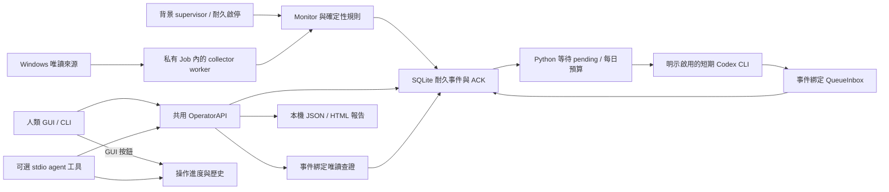

# EventGuard

Windows 一般權限的唯讀監看工具。人類 GUI／CLI 與可選 agent 介面共用核心。正常監看不呼叫模型。

定位是本機資安情報中心：以來源觀察、事件、查證及操作紀錄為基礎。GUI「操作紀錄」可看人類／agent正在做什麼與執行結果；資料與限制見 [操作紀錄](docs/ACTIVITY.md)。外部漏洞情報匯入與跨主機整合尚未實作。

**日常使用：雙擊 `EventGuard.cmd`，按「開始」持續監看、按「暫停」停止。** 視窗顯示七來源可見性、事件數與事件內容；關閉視窗只最小化，選「應用程式 → 暫停並結束」才完全離開。`Start-EventGuard.cmd` 會開啟視窗並開始。使用既有 Python 3.13／tkinter，沒有新增安裝。

「允許 agent 接收事件」預設關閉；勾選才開放既有本機工具接收，取消立即阻擋後續工具讀取，既有事件仍保留。勾選不會啟動模型，也不代表 agent 已連線。操作與限制見 [GUI](docs/GUI.md)。

採集與規則由本機程式執行，事件先存SQLite；人類或agent之後可讀保存資料、執行固定唯讀查證並匯出報告。正式MCP已在本聊天實際完成一件本機事件的讀取／查證／接收／ACK；ACK只代表收到。可選自動交付另見[接線指南](docs/CONNECT_AGENT.md)，不必設定排程、proxy或聊天喚醒才能使用監看。

事件先顯示觀察、未知與唯讀查證建議，技術資料按需展開；可依嚴重度／接收狀態篩選目前載入的100件，總數及截斷會明示。設計參考與已採納項目見 [研究記錄](docs/SCANNER_LESSONS.md)。

已補讀上游25引擎的整合碼，以及各來源repo的README／代表入口；用途、依賴與實際整合範圍見 [25引擎盤點](docs/SCANNER_ENGINES.md)、[執行邊界](docs/SCANNER_RUNTIME_REVIEW.md)。這是讀碼研究，沒有引入或執行這些引擎。

目前是 [MIT](LICENSE) 工程預覽。目前受測程式與 commit 見 [EVIDENCE](docs/EVIDENCE.md)，最新狀態見 [STATUS](STATUS.md)，實測範圍與數字見 [EVIDENCE](docs/EVIDENCE.md)。

## 如何運作



## 五分鐘 fixture 快速開始

在專案根目錄，用既有 Python 3.13。這段建立全新隔離資料目錄，只讀合成 fixture，不查 Windows 來源、不啟動 agent；`quickstart-NEW` 已存在時換新名稱。

```powershell
py -3.13 --version
$eventguardDemo = Join-Path (Get-Location) 'reports/quickstart-NEW'
New-Item -ItemType Directory -Path $eventguardDemo -ErrorAction Stop | Out-Null
New-Item -ItemType Directory -Path "$eventguardDemo/config", "$eventguardDemo/playbooks", "$eventguardDemo/tests/fixtures" | Out-Null
Copy-Item -LiteralPath 'config/default.json' -Destination "$eventguardDemo/config/default.json"
Copy-Item -LiteralPath 'playbooks/default.json' -Destination "$eventguardDemo/playbooks/default.json"
Copy-Item -LiteralPath 'tests/fixtures/normal.json' -Destination "$eventguardDemo/tests/fixtures/normal.json"
$eventguardCli = 'import sys; from pathlib import Path; sys.path.insert(0,"src"); from eventguard.cli import main; r=Path(sys.argv.pop(1)); raise SystemExit(main(root=r))'
py -3.13 -B -c $eventguardCli $eventguardDemo --format text monitor --fixture tests/fixtures/normal.json --max-cycles 1
py -3.13 -B -c $eventguardCli $eventguardDemo --format text overview --namespace test
py -3.13 -B -c $eventguardCli $eventguardDemo --format text sources show --source-id defender --namespace test
$eventguardItem = py -3.13 -B -c $eventguardCli $eventguardDemo synthetic emit --scenario listener | ConvertFrom-Json
py -3.13 -B -c $eventguardCli $eventguardDemo events inspect --namespace test --event-id $eventguardItem.event_id
$eventguardReceipt = py -3.13 -B -c $eventguardCli $eventguardDemo --format json events receive --namespace test --event-id $eventguardItem.event_id | ConvertFrom-Json
py -3.13 -B -c $eventguardCli $eventguardDemo events ack --namespace test --event-id $eventguardItem.event_id --query-id $eventguardReceipt.query_id
py -3.13 -B -c $eventguardCli $eventguardDemo report export --namespace test
```

預期顯示監看已停止、七來源保存狀態及筆數；合成 Defender 有兩筆可讀觀察。事件先 pending，明確 receive 後取得 query ID，再 ACK；ACK 只代表收到，不是修復／結案。報告提供 JSON／HTML 路徑。全程沒有模型，核心只用標準庫。

## 人類操作與可選 agent

一般權限明確啟動背景監看；採集不受每日 agent 額度或一小時期限限制：

```powershell
py -3.13 -B scripts/eventguard.py background start
py -3.13 -B scripts/eventguard.py overview --namespace live
py -3.13 -B scripts/eventguard.py sources show --source-id listeners --namespace live
py -3.13 -B scripts/eventguard.py stop
```

GUI 的開始不需要建立排程；監看由應用持有，應用縮小後繼續運作。Status／Stop-EventGuard.cmd 仍可查看／耐久暫停。獨立 CLI background start 的生命週期契約保留，與 GUI 應用持有模式分開。終端預設文字，管線預設 JSON，可用 `--format text|json` 固定。

重開機後於同一使用者登入時恢復，使用 [背景監看契約](docs/BACKGROUND.md) 的低權限 ONLOGON 排程；建立／立即執行仍需批准。若啟動端受外部 Job 約束，回報 `independent_background_unverifiable`，不繞過它；排程可直接執行同步 host。前景除錯仍可用 `monitor`。

`events list/inspect/diagnose/receive/ack/retry` 與報告操作見 [共用介面](docs/HUMAN_AGENT_INTERFACE.md)。inspect／sources 只讀保存觀察；diagnose 才執行事件綁定查詢。手動 stdio 需既有 MCP SDK及 client 明確連接；自動模式僅在另行啟用後使用單次 MCP 設定，不接續桌面聊天。

## 現況與限制

- 六來源原生API優先；Defender自動模式讀既有Get-MpComputerStatus的七項有效狀態。可讀範圍與拒讀原因見[採集契約](docs/COLLECTOR_CONTRACT.md)；partial／unknown不代表安全，不因缺資料提權。持久化事件保存有界目標事實供後續分析，身分缺失不誤判listener恢復。
- 子程序從建立時加入私有 Job；停止先寬限，逾時只清理本工具程序樹。啟動保存 `monitor_gap`，未確認退出不報 stopped；見 [生命週期](docs/PROCESS_LIFECYCLE.md)。
- 每來源即時保存有界觀察；過期、截斷與拒讀均顯示。退出未確認會耐久阻擋新 worker，僅能以該私有 Job 已空／銷毀的證據恢復；不靠刪鎖或重開目錄繞過。
- ACKed 資料與完成帳本有保留、輪替及有限上限；pending／retry／未 ACK failed 保留。去重有時間與容量窗；見 [儲存政策](docs/STORAGE_RETENTION.md)。
- 背景 supervisor 對異常／保存背壓以程式等待後重試；事件先落 SQLite。沒有事件不叫模型，有事件也由人類或已連接的可選接收者接手。
- [24 小時 soak](docs/SOAK_PLAN.md) 尚未執行，真實狀態注入／登出重開機仍未驗證。排程實際安裝狀態見 STATUS，沒有服務、登入前監看或全天候承諾。
- 不提供 EDR／鑑識、自動處置或 Linux 原生採集。沒有事件、ACK 或診斷都不能證明主機安全。
- 執行資料與憑證不入 Git。歷史有限 Codex 通路驗收見 [歷史入口](docs/history/README.md)；不是正常使用的前置條件或新的模型授權。
- 可選 CLI 共用[每日耐久預算與未知退出閘道](docs/AGENT_BUDGET.md)；未初始化或證據不足就阻擋，不因換目錄重置。接收失敗可由人類接手；不把人類 ACK 升格為 agent 驗收成功。

目前投遞／驗收已使用 [同一 QueueInbox 路徑](docs/DELIVERY_CONSOLIDATION.md)；Phase 7 [實機驗證計畫](docs/WINDOWS_VALIDATION_PLAN.md) 尚未執行。下一階段的範圍、完成條件與停止關卡見 [維護目標](docs/MAINTENANCE_GOAL.md)。離線開發與驗證見 [DEVELOPMENT](docs/DEVELOPMENT.md)。
