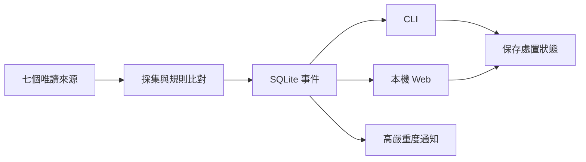

# EventGuard

Windows 本機資安監看程式。使用一般權限及 Python 3.13 標準庫。

程式自行採集、比對規則、保存事件、顯示結果。正常運作不呼叫模型。

## 開始使用

在專案目錄執行：

```powershell
.\EventGuard.cmd run
```

開啟 [本機頁面](http://127.0.0.1:8765)。可查看事件、來源狀態與規則。

程式在前景執行。按 Ctrl+C 停止。關閉網頁不會停止程式。不需要排程或 Codex。

若連接埠被使用，可加 `--port 8877`。也可直接執行 `py -3.13 -B scripts/eventguard.py run`。

## 操作流程



事件可按嚴重度、來源及處置狀態篩選。篩選後再分頁。

處置狀態為「新增、已讀、已處理、忽略」。狀態會保存。它與投遞 ACK 分開。改成已處理不會執行系統處置。

```powershell
.\EventGuard.cmd events list --severity high --source listeners --status new
.\EventGuard.cmd events detail --event-id <ID>
.\EventGuard.cmd events set-status --event-id <ID> --status read
.\EventGuard.cmd sources list
.\EventGuard.cmd rules validate
```

CLI 終端預設顯示文字。管線預設輸出 JSON。可用 `--format text` 或 `--format json` 固定。

## 設定規則

編輯 [config/rules.json](config/rules.json)。每條規則有名稱、條件及嚴重度。提供五條預設規則。條件只接受固定欄位及比較。不能執行命令。

每輪採集前會重讀規則。新事件採用新規則。舊事件不改寫。無匹配時保留原分類。壞檔會顯示錯誤。未保存的事件不會被丟棄。

## 來源與通知

來源頁顯示七來源的時間、結果、原因碼及建議。Defender 拒讀與 tasks 未知會分開說明。頁面只讀保存資料，不會因重新整理而重掃。

新的 high／critical 事件會請求 Windows 本機通知。本頁也顯示醒目提示。已處理或忽略的事件不通知。成功回條用於重開後去重。

Windows 可能抑制通知。程式接受通知要求，不代表使用者已看見。可用 `run --no-notifications` 關閉系統通知。本頁提示仍保留。

## 限制

- partial、denied、unknown、過期與空清單都不代表安全。
- 不提供 EDR、鑑識、自動處置或 Linux 原生採集。
- 不改防火牆、服務、啟動項或安全設定。不提權。不下載依賴。
- Web 只綁定 `127.0.0.1`。不提供遠端存取。資料仍受本機帳戶與檔案權限影響。
- pending 事件不因處置狀態而刪除。容量滿時明示背壓。ACKed 資料依 [保留政策](docs/STORAGE_RETENTION.md) 清理。
- 24 小時運轉與重開機尚未驗證。不作全天候承諾。
- 執行資料、憑證及私人歷史不提交 Git。

Codex MCP、閒置喚醒及開機自啟均為選配。本輪不啟用。成本與收益見 [現況](STATUS.md)。

舊 Tk GUI 仍可雙擊 `EventGuard.cmd` 開啟。歷史驗收見 [EVIDENCE](docs/EVIDENCE.md)。產品範圍見 [維護目標](docs/MAINTENANCE_GOAL.md)。本專案使用 [MIT](LICENSE)。
