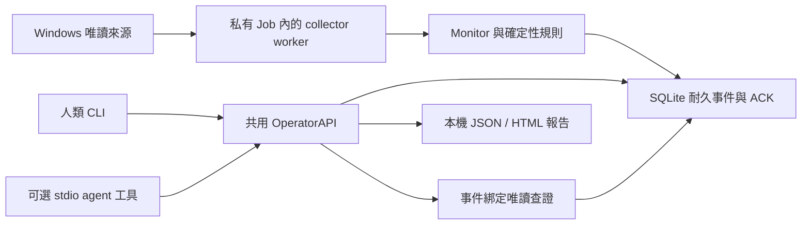

# EventGuard

Windows 一般權限的唯讀監看工具。核心能獨立採集、記錄變化、查看事件與匯出報告；人類 CLI 與可選 agent 介面共用操作核心。正常監看不呼叫模型。

目前是 [MIT](LICENSE) 工程預覽。當前程式基準 `1e90a53`，最新狀態見 [STATUS](STATUS.md)，實測範圍與數字見 [EVIDENCE](docs/EVIDENCE.md)。

## 如何運作



## 五分鐘 fixture 快速開始

在專案根目錄，用既有 Python 3.13。這段建立全新隔離資料目錄，只讀合成 fixture，不查 Windows 來源、不啟動 agent；`quickstart-NEW` 已存在時換新名稱。

```powershell
py -3.13 --version
$eventguardDemo = Join-Path (Get-Location) 'reports/quickstart-NEW'
New-Item -ItemType Directory -Path $eventguardDemo -ErrorAction Stop | Out-Null
New-Item -ItemType Directory -Path "$eventguardDemo/config", "$eventguardDemo/tests/fixtures" | Out-Null
Copy-Item -LiteralPath 'config/default.json' -Destination "$eventguardDemo/config/default.json"
Copy-Item -LiteralPath 'tests/fixtures/normal.json' -Destination "$eventguardDemo/tests/fixtures/normal.json"
$eventguardCli = 'import sys; from pathlib import Path; sys.path.insert(0,"src"); from eventguard.cli import main; r=Path(sys.argv.pop(1)); raise SystemExit(main(root=r))'
py -3.13 -B -c $eventguardCli $eventguardDemo monitor --fixture tests/fixtures/normal.json --max-cycles 1
$eventguardItem = py -3.13 -B -c $eventguardCli $eventguardDemo synthetic emit --scenario listener | ConvertFrom-Json
py -3.13 -B -c $eventguardCli $eventguardDemo events inspect --namespace test --event-id $eventguardItem.event_id
py -3.13 -B -c $eventguardCli $eventguardDemo report export --namespace test
```

預期 monitor 回傳 `state=stopped`；synthetic 事件可查看觀測、coverage 與未知，報告回傳 JSON／HTML 路徑。它仍是 pending，沒有模型接收或 ACK。核心只用標準庫，不需下載安裝。

## 人類操作與可選 agent

一般權限實際監看由人類在前景明確啟動；另一終端可查看或停止：

```powershell
py -3.13 -B scripts/eventguard.py monitor
py -3.13 -B scripts/eventguard.py status
py -3.13 -B scripts/eventguard.py stop
```

`events list/inspect/diagnose` 與 `report export` 的完整操作見 [共用介面](docs/HUMAN_AGENT_INTERFACE.md)。`diagnose` 才執行事件綁定的既有唯讀查詢；inspect 只讀已保存觀察。可選 stdio 需既有 MCP SDK，缺少就停止；不永久註冊、不自行啟動模型或接續桌面聊天。

## 現況與限制

- 原生 API 優先、同身分 PowerShell fallback；七來源的可讀範圍與拒讀原因見 [採集契約](docs/COLLECTOR_CONTRACT.md)。Defender／程序仍 partial，tasks 仍有 unknown；不因缺資料提權。
- 子程序從建立時加入私有 Job；停止先寬限，逾時只清理本工具程序樹。啟動保存 `monitor_gap`，未確認退出不報 stopped；見 [生命週期](docs/PROCESS_LIFECYCLE.md)。
- ACKed 資料與完成帳本有保留、輪替及有限上限；pending／retry／未 ACK failed 保留。去重有時間與容量窗；見 [儲存政策](docs/STORAGE_RETENTION.md)。
- [24 小時 soak](docs/SOAK_PLAN.md) 尚未執行，真實狀態注入／登出重開機仍未驗證。排程只 dry-run，沒有服務、自啟或全天候承諾。
- 不提供 EDR／鑑識、自動處置、GUI 或 Linux 原生採集。沒有事件、ACK 或診斷都不能證明主機安全。
- 執行資料與憑證不入 Git。歷史有限 Codex 通路驗收見 [歷史入口](docs/history/README.md)；不是正常使用的前置條件或新的模型授權。

下一階段的範圍、完成條件與停止關卡見 [維護目標](docs/MAINTENANCE_GOAL.md)。離線開發與驗證見 [DEVELOPMENT](docs/DEVELOPMENT.md)。
