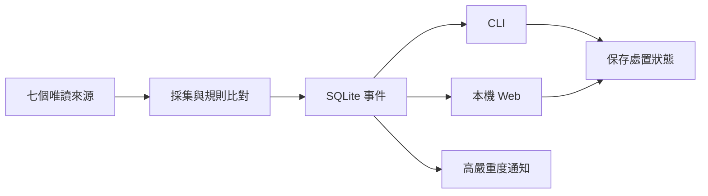

# EventGuard

Windows 本機資安監看程式。使用一般權限及 Python 3.13 標準庫。

程式自行採集、比對規則、保存事件、顯示結果。正常運作不呼叫模型。

## 開始使用

在專案目錄執行：

```powershell
.\EventGuard.cmd run
```

開啟 [本機頁面](http://127.0.0.1:8765)。可查看事件、來源狀態與規則。

程式在前景執行。按 Ctrl+C 停止。關閉網頁不會停止程式。不需要排程或 Codex。

頁面可開始、暫停、恢復及停止採集。「停止採集」保留網頁與 MCP，可再次開始。「關閉程式」才關閉應用。事件與人工處置會保存；不 ACK、不啟動 agent。外部監看或退出不明時，控制會顯示受阻。

只開控制介面可用 `.\EventGuard.cmd run --idle`。CLI、GUI 與選配 MCP 共用同一實例。頁面自動同步真實結果、操作來源與按鈕。接線與十工具見 [應用 MCP](docs/APPLICATION_MCP.md)。

實際操作與驗收界線見 [本機頁面指南](docs/LOCAL_UI_ACCEPTANCE.md)。合成頁面會明示測試資料。停止要求與實際程序退出分開確認。

若連接埠被使用，可加 `--port 8877`。也可直接執行 `py -3.13 -B scripts/eventguard.py run`。

控制已開啟的應用，不另起採集程序：

```powershell
.\EventGuard.cmd app status
.\EventGuard.cmd app start
.\EventGuard.cmd app pause
.\EventGuard.cmd app resume
.\EventGuard.cmd app stop
.\EventGuard.cmd app shutdown
```

`app stop` 只停採集。`app shutdown` 關閉應用。MCP 斷線只結束該連線；沒有應用時明示受阻，不自行冷啟動。

## 操作流程



事件可按嚴重度、來源及處置狀態篩選。篩選後再分頁。

處置狀態為「新增、已讀、已處理、忽略」。狀態會保存。它與投遞 ACK 分開。改成已處理不會執行系統處置。

事件詳情可「建立／更新保存的調查」，CLI 為 `events investigate --event-id <ID>`。兩者共用同一保存案件、關聯時間線與證據缺口，重開後可由 `events detail` 恢復；只讀已保存 metadata，不採集、不啟模型、不 ACK。關聯不等於因果或攻擊鏈，OS 帳戶 owner 缺證據時維持 UNKNOWN。界線與操作見 [保存事件調查](docs/OPERATIONS.md#保存事件調查)。

```powershell
.\EventGuard.cmd events list --severity high --source listeners --status new
.\EventGuard.cmd events detail --event-id <ID>
.\EventGuard.cmd events set-status --event-id <ID> --status read
.\EventGuard.cmd sources list
.\EventGuard.cmd rules validate
```

CLI 終端預設顯示文字。管線預設輸出 JSON。可用 `--format text` 或 `--format json` 固定。

## 設定規則

編輯 [config/rules.json](config/rules.json)。每條規則有名稱、條件及嚴重度。提供五條預設規則。條件只接受固定欄位及比較。不能執行命令。

每輪採集前會重讀規則。新事件採用新規則。舊事件不改寫。無匹配時保留原分類。壞檔會顯示錯誤。未保存的事件不會被丟棄。

## 來源與通知

來源頁顯示七來源的時間、結果、原因碼及建議。Defender 拒讀與 tasks 未知會分開說明。頁面只讀保存資料，不會因重新整理而重掃。

最後成功時間會保存。後續失敗及重開程式不會清空它。最後成功不代表目前仍可讀；來源仍分別顯示拒讀、未知或過期。

新的 high／critical 事件會請求 Windows 本機通知。本頁也顯示醒目提示。已處理或忽略的事件不通知。通知意圖先落盤，再送出。成功回條用於重開後去重。回條不明時顯示未知，不盲目重送。事件仍可查看。

Windows 可能抑制通知。程式接受通知要求，不代表使用者已看見。可用 `run --no-notifications` 關閉系統通知。本頁提示仍保留。

## 公告追蹤與適用性

新增 ZDI、RustSec、Rust／Cargo／rustup、uv、CVE 與發行版來源。設定在 [config/advisories.json](config/advisories.json)。普通程式擷取、快取、比對及保存。沒有重要變化時不呼叫模型。

```powershell
.\EventGuard.cmd advisories start
.\EventGuard.cmd advisories status
.\EventGuard.cmd advisories cases
.\EventGuard.cmd advisories stop
```

以上是正式操作命令。本批未自行啟用。預設盤點路徑為空，表示未知。只讀明確允許的 manifest、lockfile 或人工 facts。不執行工具鏈、套件或 build.rs。

事件沿用既有佇列及七欄 snapshot。agent 預設不啟用。完整證據留本機。Web「資安公告」顯示來源、時間、新鮮度與適用性；未知不代表安全。新增停用的 NVIDIA CSAF 範例，僅讀明確配置的官方公告，不掃整個 repo。操作、處理表與批准範圍見 [公告追蹤](docs/ADVISORY_TRACKER.md)。官方案例與未確認內容見 [來源契約](docs/ADVISORY_SOURCES.md)。

## 限制

- partial、denied、unknown、過期與空清單都不代表安全。
- 不提供 EDR、鑑識、自動處置或 Linux 原生採集。
- 不改防火牆、服務、啟動項或安全設定。不提權。不下載依賴。
- Web 只綁定 `127.0.0.1`。不提供遠端存取。資料仍受本機帳戶與檔案權限影響。
- pending 事件不因處置狀態而刪除。容量滿時明示背壓。ACKed 資料依 [保留政策](docs/STORAGE_RETENTION.md) 清理。
- 既有事件庫是空檔、缺表或缺必要欄位時，明示儲存錯誤，不重建空庫。已損毀內容不會被宣稱已恢復。
- 24 小時運轉與重開機尚未驗證。不作全天候承諾。
- 執行資料、憑證及私人歷史不提交 Git。

專用 agent 派送提供 `agent start / status / pause / resume / stop`。start 預設只預檢；加 `--execute` 才允許模型。已完成一件合成事件交給真原生 Codex CLI 的 receive → query → 保存結果 → ACK，並驗證五層程序自然退出。操作入口、已保存結果與 ACK 的讀檔方法、單事件流程見 [AGENT_SERVICE](docs/AGENT_SERVICE.md)。正式來源的持續派送仍需適用批准；此證據不涵蓋原生主機採集、既有桌面喚醒、24 小時 production 或 reboot。

Codex 接線、桌面閒置喚醒及開機自啟均為選配。MCP 操作不代表閒置喚醒。官方入口研究見 [事件驅動](docs/AGENT_EVENT_DRIVEN.md)，OpenOctopus 的提案見 [協定](docs/OPENOCTOPUS_EVENT_PROTOCOL.md)。成本與收益見 [維護目標](docs/MAINTENANCE_GOAL.md)。

舊 Tk GUI 仍可雙擊 `EventGuard.cmd` 開啟。歷史驗收見 [EVIDENCE](docs/EVIDENCE.md)。產品範圍見 [維護目標](docs/MAINTENANCE_GOAL.md)。本專案使用 [MIT](LICENSE)。
