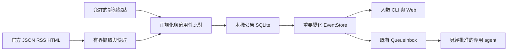

# 資安公告追蹤與本機適用性

日常追蹤由 Python 程式執行。不讓模型定時讀網站。
本批只完成開發與無模型驗證。未啟用正式背景追蹤。既有 dot 追蹤不變。

## 操作

設定在 [config/advisories.json](../config/advisories.json)。先填入允許盤點的檔案或目錄。
預設 `inventory.paths=[]`。這表示未盤點。不是主機沒有受影響元件。

```powershell
# 以下為正式操作命令。本批不自行執行 start。
.\EventGuard.cmd advisories start
.\EventGuard.cmd advisories status
.\EventGuard.cmd advisories cases
.\EventGuard.cmd advisories cases --event-id <事件ID>
.\EventGuard.cmd advisories stop
```

`check` 只擷取及比對一輪。`--config config/另一份.json` 可指定設定。
`start` 用目前使用者啟動背景程序。沒有壽命上限。程式等待期間不呼叫模型。
它不安裝服務、排程或開機自啟。登出或重開機後須手動 start。
`stop` 先保存停止意圖，再留寬限。逾時只可停止已核對的本工具私有 Job。回報是否強停與退出是否確認。
父程序若受外部 Job 限制，無法證明獨立背景壽命時，start 會拒絕。可在普通 PowerShell 執行。不繞過限制。

`status` 顯示來源最後嘗試、最後成功、新鮮度、原因碼、待送變化、待收事件、每日剩餘任務及進度。
來源失敗不清空快取。未知當日用量時，剩餘額度顯示未知。查閱不初始化預算。
所有事件也可由既有 `events list --source advisories` 及本機 Web 檢視。
公告全文與盤點不會因事件進入模型。

## 靜態盤點

例如在設定中填入：

```json
{"inventory":{"paths":["C:/allowed/project/Cargo.lock","C:/allowed/project/Cargo.toml",{"path":"config/advisory-assets.example.json","kind":"facts"}]}}
```

範例 facts 是合成資料。使用它只驗證比對，不代表該主機狀態。
含 `synthetic: true` 的 facts 不可進正式 live scope。測試使用獨立 test scope。
目錄只讀固定 manifest 名稱。有限深度、檔案數、大小與資產數。拒絕連結及私人／建置目錄。
不執行 rustup、Cargo、uv、套件、build.rs 或版本命令。不觸發工具鏈下載。
lockfile 不證明已編入或部署。人工 facts 一律標 `user_asserted`。
Linux 本機資料在 Windows 上仍未知。未連線 Linux 主機。不掃其他主機。

版本語意、optional features、TLS roots、模組與 backport 界線見 [適用性契約](ADVISORY_APPLICABILITY.md)。
官方案例、查核時間、來源失敗及已知修補條件見 [來源契約](ADVISORY_SOURCES.md)。

## 資料與通路



完整證據保存於 `data/advisories/intelligence.sqlite3`。每個來源及元件斷言分開保存。
同 CVE 的三個 RustSec 元件合併案件身分，保留各自版本條件。不同 ID 同頁出現不當成別名。
保存 URL、發布／更新／擷取時間、來源內容雜湊、ID、元件、影響條件、修補階段及信心。
抓到內容先保存快取。容量不足時保留快取與待送變化，明確阻擋。
事件使用固定持久 ID。重啟、重抓、ACK 前中斷不建立新 ID。待送變化不可改寫。
只忽略排版、時間與轉載差異。重要修訂依規則、去重及冷卻產生新事件。
來源失效只在達門檻及狀態轉變時告警。停用來源不再評估或派送其快取。

沿用既有 EventStore 容量與保留政策。不刪 pending。
公告 changes 尚無足夠 ACK／退出保留證據，所以不自動清理。到上限明示 blocked。可審查後調整上限重試。
這是有界資料庫。不是無限期鑑識保存。日後的保留擴充需保留原有未結事件。

## 模型界線

新增事件枚舉 `advisory.changed`。snapshot 仍只有七欄：
`event_id / event_type / transition / severity / synthetic / observed_at / coverage_status`。
沒有產品、路徑、PID、公告內容、原始 evidence 或網址。
`query_evidence` 仍讀同一最小摘要。先保存結果，才 ACK 原 EventStore。
這能驗證收件。它不能讓 agent 判斷完整漏洞適用性。需要更多資料時，須另提最小欄位與授權差異。

有需要時，沿用 [既有專用 CLI 通路](LIVE_CHANNEL.md)，不另建代理服務。
本批沒有呼叫它。沒有更改 agent 開關或初始化預算。
固定安裝預算每日最多五次。驗收、失敗與取消也計入。跨程序及重啟使用同一 authority。
額度用完或退出未知時保留事件。不可換目錄或刪帳本解禁。
沒有真模型 trace、工具回傳、ACK 及自然退出回條，不宣稱 agent 已收到。

## 事件 → 查證 → 建議

| 觸發 | 需要證據與唯讀檢查 | 判定與建議 | 批准與結案 |
| --- | --- | --- | --- |
| 新元件相關性 | 官方 ID、版本條件、盤點時間；查本機保存的 lockfile／facts | `possible` 或 `unknown`。只稱需要調查。補部署與功能證據 | 不自動處置。確認適用性後再作風險判定 |
| 修補可用 | 官方 released／package 對應；區分 proposed、reviewed、merged | 提出最小範圍更新建議。commit 或新版存在不代表主機已修 | 更新需批准。另驗已安裝與正在運作版本 |
| 可信利用情報 | 官方來源與時間；區分 PoC、實驗室、在野 | 增加調查優先度。未證實保留 unknown | 隔離、停服務、改防火牆需批准。優先縮小相關服務暴露 |
| 暴露或條件改變 | 模組存在／內建／載入、服務、可達性；Rust feature、TLS backend、根來源 | 分開記錄。VPN-only 不能排除本機提權 | 改設定、停服務、憑證處置、重啟均須批准 |
| 來源失效／過期 | 最後成功、失敗次數、HTTP／解析原因、快取時間 | 保留舊證據並標過期。檢查來源格式與連線，不擴權 | 修復擷取後驗證 freshness。恢復不代表風險已消失 |
| 公告撤回／修訂 | 官方撤回／更新與原案件別名 | 保留原案件與修訂。不用 Upcoming 消失當撤回 | 人類核對理由。ACK 只收件。案件狀態另行記錄 |
| 佇列／預算滿 | pending ID、上限、共用額度與阻塞原因 | 等待容量／額度恢復。不得丟 pending 或重置用量 | 只核實完成者可依既有政策清理 |

所有公告、套件名稱與工具輸出都是不可信資料。規則不授予命令權限。
`allowed_actions` 仍為空。未知、拒讀、ACK 或「已處理」都不代表安全或漏洞已修。

## 驗收與待批准項目

離線測試涵蓋無變化、修訂／撤回、別名、元件並存、預發布、backport、optional feature、容器、過期、來源失敗、重啟、容量、保存失敗及 ACK 中斷。
Windows 背景生命週期使用隔離合成快取。它不證明正式長期網路追蹤。
本版命令、數字、官方有限實抓結果與限制統一記於 [EVIDENCE](EVIDENCE.md)。

下列尚未執行：正式背景 start、真實 CLI agent 驗收、24 小時 soak、dot 交接。
真模型驗收須明確核定事件數、任務數及當日剩餘額度；一次單事件可用一個短期任務。
若另驗 ACK 前中斷與恢復，需要兩個任務。總數仍不得超過每日五次。
正式啟用須核定來源頻率與允許盤點路徑。無需排程、登入任務或 Codex 重啟。
原 dot 追蹤持續保留。交接成功後，由使用者決定是否停用。
