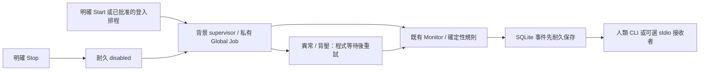

# 長期背景監看與登入後恢復

本批基底 `08a4ef8ff7e5762c499b7cb270de1e86a0361822`。使用者已要求實作及一般權限驗證；真排程建立與真模型仍需當次批准。這份契約不等於排程已安裝、實際重開機或24小時測試已完成；當前證據見 [EVIDENCE](EVIDENCE.md)。

## 正常使用

```powershell
.\Start-EventGuard.cmd
.\Status-EventGuard.cmd
.\Stop-EventGuard.cmd
```

Start 現在啟動背景控制程序，保存 enabled 意圖；沒有每天／一小時的採集停止期限，不使用模型額度。Status 分開核對背景 owner PID＋建立時間、私有 Job、heartbeat、目前採集 owner、coverage、保存資料及事件。Stop 先耐久寫 disabled，再合作停止；未確認退出不判成功。重新登入不會推翻明確手動停止，需再次 Start 才啟用。

等價 CLI 為 `background start/status/stop`。要在終端前景觀察來源進度，仍可明確使用 `monitor`；它不是新的背景啟動入口。事件持續保存在同一 `data/live/eventguard.sqlite3`，人類／已連接的可選 stdio client 用原有 events list/inspect/diagnose/receive/ack 接手；沒有新增另一套接收帳本。無事件不叫模型；有事件也不自行花模型額度。



## 生命週期、恢復與容量

- 手動啟動：launcher 先將 host 原子加入私有 named Job，host 持有相同 Job 的 keeper；ready/run 身分與實際 handle 對照成功才交接。交接不是已退出回條。host 不依賴 launcher 的 stdio，stdout/stderr 不無限增長。
- launcher 若受外部 Job 約束，不能保證關閉該工具後仍存活；production 回 `independent_background_unverifiable`，不 breakaway 或改外部 Job。測試可注入受 guardian 約束的有限 host，必須明示生命週期受限。
- 排程直接同步執行 `background serve`。它只恢復既有 enabled 意圖，先取得同 root host lease、核對舊 owner/Job，再加入自己的私有 Job；不再啟動一個立即退出的 launcher。Task Scheduler 可以管理祖先 Job，EventGuard 不改它。
- 新 host 與查詢 worker 的 Job 使用固定前綴加隨機 UUID 的 `Global\EventGuard-…`，可跨登入 session 核對。只有明確空／不存在才判舊 Job 已清空；拒讀為未知。舊 Local Job 缺相同 session 證據不能用新 session 的「不存在」清閘道。沒有猜測 undocumented boot GUID。
- 正常 host 持有 keeper 直到 OS 自然退出；不提早 close 最後一個 Job handle 導致自殺。異常 owner exit 時 Windows 的 KILL_ON_JOB_CLOSE 管理本工具子樹，事件仍留 SQLite；下次 Monitor 先保存 monitor_gap，缺口不是無事件。
- Monitor 例外、意外返回或持久化背壓由普通程式按5/15/30/60/120/300秒等待後重試。手動停止及Ctrl+C會保存disabled，不能當作意外退出重開。控制檔不可讀、未知退出及來源拒讀不能變成成功。
- 佇列滿／觀察保存失敗時停止後續新採集，保留舊 baseline 與所有 pending；報錯並等待。恢復前 monitor_gap 也必須先落盤。ACK 釋放容量後再重試；無法保存期間是可見的監看缺口，不承諾還原當時所有變化。
- 使用原有 SQLite／ACKed保留、有限帳本、觀察投影及輪替操作日誌；只新增固定數量的背景 control/launch/owner/run/ready/handoff/stop 回條，沒有每輪新的 report 或完整 stdout 檔。配置／資料夾被同使用者篡改仍不在防護保證內。

Global namespace與Job的文件依據是 [Microsoft Kernel object namespaces](https://learn.microsoft.com/en-us/windows/win32/termserv/kernel-object-namespaces) 及 [Job Objects](https://learn.microsoft.com/en-us/windows/win32/procthread/job-objects)。實際 handle 比對依 [CompareObjectHandles](https://learn.microsoft.com/en-us/windows/win32/api/handleapi/nf-handleapi-compareobjecthandles) 從 System32 的 Kernelbase.dll 載入，缺 API 時拒絕交接。這裡不啟用額外權限或更改 ACL；建立／查詢被拒就回報。

## 排程批准內容

```powershell
py -3.13 -B scripts/eventguard_schedule.py install --dry-run --start-now --plan-dir reports/schedule-review-NEW
```

預設只查本安裝、目前使用者專用的確定名稱任務，並保存 plan.json／UTF-16 task.xml／SHA256。讀既有任務先核對固定 Source／URI／root／UserId，符合才讀本工具定義；外來同名任務不讀完整 actions、不覆蓋、不刪除。計畫綁定固定 Python、全部核心 Python、設定／playbook hashes，變更後要重新審查。查詢分 COM/connect/GetFolder/GetTask/definition/XML；只有已確認 parent folder 且 GetTask 明確找不到，才判任務不存在，不能把 GetFolder 失敗當成不存在。

批准範圍只需一個目前使用者 **ONLOGON／InteractiveToken／LeastPrivilege** 任務；同步執行既有 Python 3.13／同安裝 pythonw，期限 PT0S，不因idle或電池停止，不要求網路／喚醒／密碼／服務／UAC。失敗由排程每分鐘重試最多三次，正常來源例外另由 host 有界 backoff；不承諾所有故障永久可自癒。

實際 mutation 必須 `--execute --approved-plan-sha256 <本次SHA256>`，若計畫／source／身份變更即拒絕。Create不帶覆寫，已存在的本工具任務必須完整定義匹配；可選 start-now 只在批准計畫包含時送一次 Run，Run成功還需背景heartbeat核對。uninstall也需專屬批准plan，只移除匹配的註冊，不代替停止監看。

這是**同一使用者登入後**恢復。登入前監看不在普通互動token範圍，不新增服務、帳戶／憑證或修改自動登入。實際重開機／登出測試由使用者另行安排，程式不主動重開機。

目前尚未完成的長時與實機故障項目依 [SOAK_PLAN](SOAK_PLAN.md) 與 [WINDOWS_VALIDATION_PLAN](WINDOWS_VALIDATION_PLAN.md) 分開記錄；有限 fixture／owned Job 測試不能升格為已通過重開機或全天候驗收。
