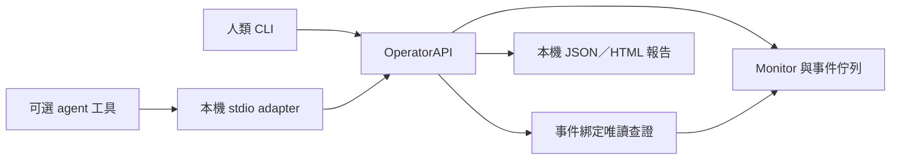

# 人類與 agent 共用的本機操作介面

使用者已明確選定方向：**EventGuard 必須能獨立運作；人類能操控及了解發生什麼，agent 透過同一套能力協助人類。** 此決定取代先前等待 A／B 二選一的關卡；不是批准啟動模型、永久註冊 MCP 或擴大權限。

核心為 Python 3.13 標準庫。正常採集、規則、耐久事件、確定性說明、診斷保存與報告不需要 agent／SDK／模型；可選 stdio adapter 才使用已安裝的 MCP SDK。沒有模型啟動或模型輪詢的新路徑。



核心不 import MCP。原有三工具 receive/query/ACK 接收契約保留相容；新 operator mode 是同一 stdio 入口的操作介面，沒有新增另一套投遞帳本或自動喚醒機制。

## 先讓人類獨立使用

以下在專案根目錄、既有 Python 3.13 執行。這組只做 fixture／合成事件，不查 Windows 來源、不啟動模型：

```powershell
py -3.13 -B scripts/eventguard.py monitor --fixture tests/fixtures/normal.json --max-cycles 1
py -3.13 -B scripts/eventguard.py overview --namespace test
py -3.13 -B scripts/eventguard.py sources show --source-id defender --namespace test
$eventguardItem = py -3.13 -B scripts/eventguard.py synthetic emit --scenario listener | ConvertFrom-Json
py -3.13 -B scripts/eventguard.py events list --namespace test
py -3.13 -B scripts/eventguard.py events inspect --namespace test --event-id $eventguardItem.event_id
$eventguardReceipt = py -3.13 -B scripts/eventguard.py --format json events receive --namespace test --event-id $eventguardItem.event_id | ConvertFrom-Json
py -3.13 -B scripts/eventguard.py events ack --namespace test --event-id $eventguardItem.event_id --query-id $eventguardReceipt.query_id
py -3.13 -B scripts/eventguard.py report export --namespace test
```

`inspect` 顯示發生的事件、固定觀測說明、允許的事實、coverage 與未知；只讀保存資料，不假裝目前仍是相同狀態。`report export` 回傳 JSON／HTML 位置，HTML 有可讀事件表和展開的結構化證據。兩者即使完全沒有 agent 也能使用。

互動終端預設可讀文字，管線預設單一 JSON；`--format text|json` 可放子命令前後。文字監看進度寫 stderr（慢來源最多每五秒提示），JSON stdout 不混入進度。`sources show` 只讀各來源最後保存的白名單投影，最多保存 200 列／1 MiB，回傳 total／exported／truncated 及 freshness。已保存可讀但過期時，目前可見性仍 unknown。

`receive` 先以共用 QueueInbox 保存最小 snapshot/query，回傳同 event/query ID，但事件仍 pending；`ack` 才產生一次耐久回條，重複 ACK 不新增回條。`retry` 僅明確重試單一 failed outbox，不清每日預算或來源三次上限，也不啟動模型。ACK 是「收到」，與診斷、處置及案件結束分開。

重播 ACK 必須是相同 event／query／decision，且既有 inbox 與來源回條可互相驗證，才回 ack_replay_verified=true；驗證只讀，不重建或寫入接收資料。錯 query 回 same_event_query_required，換 decision 回 inbox_result_decision_conflict；既有證據缺失／已輪替回 ack_replay_evidence_unavailable，來源回條衝突回 outbox_ack_identity_conflict。事件已 ACK 仍可唯讀 receive 顯示 already_received，這不代表任何輸入 query 都有效。

`status.last_report`（相容欄位 `health`）是歷史回報；`current_monitor` 才是當次單一 owner PID+建立時間與 heartbeat 的核對，沒有獨立 watchdog。`source_coverage` 分開顯示保存狀態與 freshness；future/stale/缺資料為 unknown。每個 namespace 的 DB 故障各自呈現，不以零筆冒充成功。`agent_budget` 顯示同安裝[耐久預算](AGENT_BUDGET.md)及阻塞原因，不初始化帳本。報告顯示 total/exported/truncated/limit，最多輸出 1,000 筆保存事件，不能把匯出數當總數。

`overview`（正式 MCP 的 status／overview 共用）合併完全相同的安全錯誤樣本，`sample_occurrences` 只計有界樣本中重複幾次；總失敗次數仍看 `error_count`，省略仍看 `errors_truncated`。不同 stage／reason／異常類型／OS碼不合併，各次 attempt 順序與狀態保留。原始 status、保存觀察及採集契約不變，需詳細資料時使用 `sources show`／observation；讀 overview 不重掃或改寫觀察。

一般權限的實際監看仍由人類明確啟動前景程序，另一終端可查狀態或合作停止：

```powershell
python -B scripts/eventguard.py monitor
python -B scripts/eventguard.py status
python -B scripts/eventguard.py stop
```

需要查目前狀態時，先從 `events list --namespace live` 取得 event_id，再執行：

```powershell
python -B scripts/eventguard.py events inspect --namespace live --event-id EVENT_ID
python -B scripts/eventguard.py events diagnose --namespace live --event-id EVENT_ID
```

`EVENT_ID` 要換成實際 ID，不是範例事件。`diagnose` 才明確執行事件綁定的既有唯讀查詢，保存後可再次 inspect 或 export。沒有任意命令、自由查詢字串、模型、處置或 ACK。合成事件預設拒絕原生查詢；測試注入的 fixture 診斷另標 fixture_queries_executed，不得當實機證據。

## 相同核心的 agent 工具

可選入口仍為 `scripts/eventguard_inbox_mcp.py`：

```powershell
python -B scripts/eventguard_inbox_mcp.py --operator-root . --namespace test
```

這是供支援 stdio MCP 的本機 client 連接的 command/args，單獨執行只等 stdin，不會啟動模型或監看。不下載 SDK、不寫全域／專案 MCP 設定、不建立網路 listener。缺 SDK 即退出。需要實機 scope 時，操作者須明確選 `--namespace live --allow-live`；工具參數不能改 namespace／root／來源。

| 操作 | 人類 CLI | stdio tool／共同核心 |
| --- | --- | --- |
| 能力 | capabilities | capabilities → OperatorAPI.capabilities |
| 全域狀態 | status | stdio status → OperatorAPI.overview（固定 launcher namespace，limit=1） |
| 操作總覽／逐來源 coverage | overview --namespace … | overview → OperatorAPI.overview |
| 操作進度與歷史 | activity --namespace … --limit … | activity → 同一份有界本機操作紀錄 |
| 保存來源觀察 | sources show --source-id … --namespace … | observation → OperatorAPI.observation |
| 持續開始監看 | background start | start_monitor → OperatorAPI.background_start；只限已開放的live launcher，test拒絕 |
| 一輪監看 | monitor --max-cycles 1 --max-seconds 30（test 另加固定 fixture） | monitor_once → OperatorAPI.monitor；test 固定 normal.json，live 需 launcher opt-in |
| 合作停止 | stop --namespace test 或 live | stop → OperatorAPI.stop；只能停止 namespace 與 instance 均相符的本工具 owner |
| 事件清單 | events list --namespace … --limit … | list_events → OperatorAPI.events |
| 保存觀察與最近診斷 | events inspect --event-id … --namespace … | inspect_event → OperatorAPI.inspect_event |
| 目前唯讀查證 | events diagnose --event-id … --namespace … | diagnose_event → OperatorAPI.diagnose_event |
| 接收／取得 query ID | events receive --event-id … --namespace … | receive_event → OperatorAPI.receive_event |
| 明確 ACK | events ack --event-id … --query-id … --namespace … | ack_event → OperatorAPI.ack_event |
| 單一失敗重試 | events retry --event-id … --namespace … | retry_event → OperatorAPI.retry_event |
| 人類可讀報告 | report export --namespace … | report → OperatorAPI.report |

同一 scope 的事件清單／檢視使用完全相同的結構化資料，沒有為 agent 把「重讀摘要」改名成診斷。CLI 與 MCP 的新公開操作也共用固定錯誤 envelope，不回傳原始 OS 例外或私人錯誤路徑。

operator的多個stdio client不持有終身exclusive鎖。MCP狀態變更操作以短期lease序列化，忙碌明示`operator_operation_busy`且不開始、不自動重試；讀取與Stop不經該鎖。SQLite／QueueInbox／背景核心仍保留自己的交易與ownership，這不是所有GUI/CLI動作共用的一筆全域交易。scoped Stop在控制鎖內核對namespace，綁原instance/run與Job；換代後回busy，不能追停新owner。無效instance ID不得退化為global Stop。人類未指定scope的全域暫停行為保留；legacy單事件stdio仍只有一個owner。

operator MCP的`start_monitor`選用既有application-owned核心，與CLI預設independent生命週期分開；capabilities明示`start_lifetime_owner=application`及`owner_exit_stops_monitor=true`。不限制採集時長、不啟動模型；server／祖先Job退出也會停止自身監看，不能宣稱重開機持續。EOF只收尾本API新啟動並保留handle的Job，以原run/generation/namespace/job守衛避免停錯新owner；已有其他client監看只返回already_running，不收養。收尾回條及失敗exit2見[生命週期](PROCESS_LIFECYCLE.md)，重新載入及本聊天實測限制見[接線](CONNECT_AGENT.md)。

完整operator adapter共有15個工具（含activity）。`start_monitor`只呼叫現有背景核心；`stop`已能對該scope耐久暫停，不另建第二套控制器。開始不啟用自動agent、不初始化模型預算、不建立排程。既有背景Job／owner限制仍有效；若回blocked，不能宣稱已開始或繞過限制。test launcher的start_monitor固定拒絕，不能因連合成佇列而啟動正式採集。

目前使用者已批准EventGuard正式MCP方向，要求所有操作在EventGuard看得到。實際註冊、工具載入與呼叫結果仍須核對STATUS；程式有15工具不等於client已載入。共享operator每次操作寫入[操作紀錄](ACTIVITY.md)，不把工具輸出當成授權。

「整個可供agent使用」指正常產品操作：狀態／coverage、保存觀察、開始／暫停、固定唯讀查證、事件接收／ACK／重試與報告。它不包含任意命令、提權、系統修補、任意檔案、排程安裝或自動模型啟用。資料存取開關仍由人類控制，agent不能自行給自己權限。這也不解決閒置聊天喚醒，後者需要另一個已驗證的client事件觸發入口。

長期前景監看仍用 CLI；MCP `monitor_once` 一次一輪，避免讓模型靠永久工具等待維持監看。Phase 3 已將 native 呼叫移入私有 Job worker；到期／取消先留寬限，再只清理本工具 Job，保存實際退出或未確認狀態。清理本身另有有限等待，30 秒不是硬即時總上限，詳見 [生命週期](PROCESS_LIFECYCLE.md)。目前主聊天已實際使用正式工具，未驗證全天候、閒置自動喚醒或任意既有聊天接續。

新版專案Monitor、CLI query與事件diagnose在查詢spawn前先保存確切私有Job計畫，短期lease涵蓋計畫到spawn，避免另一client在尚未建立Job時清除它。保存失敗就不啟動查詢；舊Job未確認則busy，恢復證據未保存也不清gate。capabilities的`query_admission=durable_job_intent_v1`與scope可核對載入版本，rootless library須明確傳hook；舊server不熱更新。診斷若全部在policy閘道被拒且零spawn，`system_query_executed=false`，busy／unknown仍可保存供人類查看；不是查證完成或安全結論。細節見[生命週期](PROCESS_LIFECYCLE.md)。

Runner也不會覆蓋同輪上一個未知子樹。再次啟動先僅QUERY記錄的私有named Job，確認為空／已銷毀才恢復，拒讀與缺失身分保持blocked。已接收而無成功agent trace的事件可在全部子樹確認退出後以`received_without_agent_proof`歸檔，passed仍false；完整evidence位置與attempts留存，不清預算。如果receiver證據已先輪替而無法重證則保持背壓，不能猜成功。

## 查證與信任邊界

- 從耐久事件 ID 讀取及核對 payload hash，按固定事件型別綁定既有操作；agent 不能換 PID、port、來源、命令或路徑。規則、名稱、工具輸出及事件本身都不提供授權。
- listener 以事件 protocol／port 查證；只有已保存的 process_instance_ref 才能查原程序實例。舊事件缺該 ref 時明示 process_binding_missing，不從今天的 PID 建立時間補出歷史身分。
- persistence 僅 startup／services／tasks 的 current_only；Defender 保留 partial／unknown 與 authority。coverage 事件不自動觸發全來源重掃。沒有威脅歷史、簽章或未實作的 playbook 操作擴充。
- 新persistence事件保存最多5筆目標entries，entry_ref與changed_keys一致；含固定狀態及有界名稱投影，沒有路徑或命令。目標日後消失時仍能讀歷史事實。查證只按事件refs在截斷前篩選，避免列出前20個無關服務；目前查無結果不等於恢復。
- 新查證與保存快取都驗operation／來源／port／程序實例／entry_ref綁定。舊persistence快取缺ref時清空無法綁定列並標saved_diagnosis_binding_unverifiable；沒有目標ref的舊事件不自動改為整來源查詢。名稱仍是不可信資料，ACK與安全判斷分開。
- 名稱預設有 opaque name_ref，只有 ASCII `[A-Za-z0-9_.-]` 且 ≤80 字元才附 display_name；其他名稱省略。路徑不進入共用事件／診斷事實。即使顯示名稱符合格式，仍只是 untrusted_data，不可能成為命令或授權。
- 診斷列 observations、coverage、uncertainties、觀測時間；incident_conclusion 固定 not_assessed。空列不等於恢復，ACK、查證、案件結案分開。保存診斷不改 outbox 的 pending／ACK／receipt。
- 每事件最多保留一份最新診斷，存於同一 SQLite 的 event_reviews；每份 ≤64 KiB，受原 outbox byte cap 與 ACK reserve 約束。超限明確報錯、回滾，不刪 pending；既有事件輪替時同時清理其診斷，不另建立無限帳本。
- inspect 中 latest_diagnosis 是有時間戳的已保存結果，不會因讀取而重新採集；要新觀察必須明確 diagnose。保存值重新驗證 schema／字串／payload，不把 hash 當成對抗同使用者篡改的安全邊界。
- HTML 的原始事件 metadata 只作本機證據且 escape；SDK 工具僅回本機報告位置，不自動外傳檔案。公開文件不含本機執行資料。

## Phase 2 的歷史驗證範圍

`tests/test_operator_api.py` 覆蓋 CLI／API／SDK view 等價、無 SDK 核心 fixture 監看、唯讀視圖不建資料庫、事件綁定、PID 重用、名稱／控制字元／超長／Unicode 對抗案例、拒讀／截斷／空列、容量回滾、保存與重啟讀取、篡改拒絕、namespace 停止範圍及公開錯誤最小化。

另以真 Python stdio 子程序、已安裝 SDK 與合成資料實際呼叫八個 operator tools，保存 request／response 與自然 EOF exit 回條。這是協定測試，**沒有真 Codex／模型，也沒有本輪 Windows 採集成功證明**。舊三工具驗收測試保留。

該次 Python／來源 hashes、命令、輸出及 SDK trace 留在忽略的 `reports/phase2-operator-001/verified`。demo-final 另保存獨立 CLI／fixture 診斷及三事件報告，0 ACK。最新與歷史測試數統一查 [EVIDENCE](EVIDENCE.md)；本節不代表新真 agent 診斷／效益證據。
