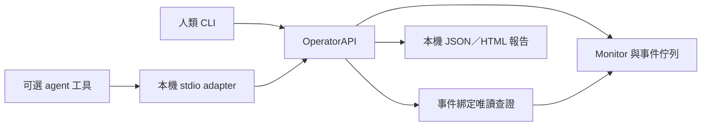

# 人類與 agent 共用的本機操作介面

使用者已明確選定方向：**EventGuard 必須能獨立運作；人類能操控及了解發生什麼，agent 透過同一套能力協助人類。** 此決定取代先前等待 A／B 二選一的關卡；不是批准啟動模型、永久註冊 MCP 或擴大權限。

核心為 Python 3.13 標準庫。正常採集、規則、耐久事件、確定性說明、診斷保存與報告不需要 agent／SDK／模型；可選 stdio adapter 才使用已安裝的 MCP SDK。沒有模型啟動或模型輪詢的新路徑。



核心不 import MCP。原有三工具 receive/query/ACK 接收契約保留相容；新 operator mode 是同一 stdio 入口的操作介面，沒有新增另一套投遞帳本或自動喚醒機制。

## 先讓人類獨立使用

以下在專案根目錄、既有 Python 3.13 執行。這組只做 fixture／合成事件，不查 Windows 來源、不啟動模型：

```powershell
python -B scripts/eventguard.py monitor --fixture tests/fixtures/normal.json --max-cycles 1
$eventguardItem = python -B scripts/eventguard.py synthetic emit --scenario listener | ConvertFrom-Json
python -B scripts/eventguard.py events list --namespace test
python -B scripts/eventguard.py events inspect --namespace test --event-id $eventguardItem.event_id
python -B scripts/eventguard.py report export --namespace test
```

`inspect` 顯示發生的事件、固定觀測說明、允許的事實、coverage 與未知；只讀保存資料，不假裝目前仍是相同狀態。`report export` 回傳 JSON／HTML 位置，HTML 有可讀事件表和展開的結構化證據。兩者即使完全沒有 agent 也能使用。

一般權限的實際監看仍由人類明確啟動前景程序，另一終端可查狀態或合作停止：

```powershell
python -B scripts/eventguard.py monitor
python -B scripts/eventguard.py status
python -B scripts/eventguard.py stop
```

需要查目前狀態時，先從 `events list --namespace live` 取得 event_id，再執行：

```powershell
python -B scripts/eventguard.py events inspect --namespace live --event-id EVENT_ID
python -B scripts/eventguard.py events diagnose --namespace live --event-id EVENT_ID
```

`EVENT_ID` 要換成實際 ID，不是範例事件。`diagnose` 才明確執行事件綁定的既有唯讀查詢，保存後可再次 inspect 或 export。沒有任意命令、自由查詢字串、模型、處置或 ACK。合成事件預設拒絕原生查詢；測試注入的 fixture 診斷另標 fixture_queries_executed，不得當實機證據。

## 相同核心的 agent 工具

可選入口仍為 `scripts/eventguard_inbox_mcp.py`：

```powershell
python -B scripts/eventguard_inbox_mcp.py --operator-root . --namespace test
```

這是供支援 stdio MCP 的本機 client 連接的 command/args，單獨執行只等 stdin，不會啟動模型或監看。不下載 SDK、不寫全域／專案 MCP 設定、不建立網路 listener。缺 SDK 即退出。需要實機 scope 時，操作者須明確選 `--namespace live --allow-live`；工具參數不能改 namespace／root／來源。

| 操作 | 人類 CLI | stdio tool／共同核心 |
| --- | --- | --- |
| 能力 | capabilities | capabilities → OperatorAPI.capabilities |
| 狀態／逐來源 coverage | status | status → OperatorAPI.status |
| 一輪監看 | monitor --max-cycles 1 --max-seconds 30（test 另加固定 fixture） | monitor_once → OperatorAPI.monitor；test 固定 normal.json，live 需 launcher opt-in |
| 合作停止 | stop --namespace test 或 live | stop → OperatorAPI.stop；只能停止 namespace 與 instance 均相符的本工具 owner |
| 事件清單 | events list --namespace … --limit … | list_events → OperatorAPI.events |
| 保存觀察與最近診斷 | events inspect --event-id … --namespace … | inspect_event → OperatorAPI.inspect_event |
| 目前唯讀查證 | events diagnose --event-id … --namespace … | diagnose_event → OperatorAPI.diagnose_event |
| 人類可讀報告 | report export --namespace … | report → OperatorAPI.report |

同一 scope 的事件清單／檢視使用完全相同的結構化資料，沒有為 agent 把「重讀摘要」改名成診斷。CLI 與 MCP 的新公開操作也共用固定錯誤 envelope，不回傳原始 OS 例外或私人錯誤路徑。

長期前景監看仍用 CLI；MCP `monitor_once` 一次一輪，避免讓模型靠永久工具等待維持監看。Phase 3 已將 native 呼叫移入私有 Job worker；到期／取消先留寬限，再只清理本工具 Job，保存實際退出或未確認狀態。清理本身另有有限等待，30 秒不是硬即時總上限，詳見 [生命週期](PROCESS_LIFECYCLE.md)。未驗證全天候、任意既有聊天接續或將工具載入目前 agent。

## 查證與信任邊界

- 從耐久事件 ID 讀取及核對 payload hash，按固定事件型別綁定既有操作；agent 不能換 PID、port、來源、命令或路徑。規則、名稱、工具輸出及事件本身都不提供授權。
- listener 以事件 protocol／port 查證；只有已保存的 process_instance_ref 才能查原程序實例。舊事件缺該 ref 時明示 process_binding_missing，不從今天的 PID 建立時間補出歷史身分。
- persistence 僅 startup／services／tasks 的 current_only；Defender 保留 partial／unknown 與 authority。coverage 事件不自動觸發全來源重掃。沒有威脅歷史、簽章或未實作的 playbook 操作擴充。
- 名稱預設有 opaque name_ref，只有 ASCII `[A-Za-z0-9_.-]` 且 ≤80 字元才附 display_name；其他名稱省略。路徑不進入共用事件／診斷事實。即使顯示名稱符合格式，仍只是 untrusted_data，不可能成為命令或授權。
- 診斷列 observations、coverage、uncertainties、觀測時間；incident_conclusion 固定 not_assessed。空列不等於恢復，ACK、查證、案件結案分開。保存診斷不改 outbox 的 pending／ACK／receipt。
- 每事件最多保留一份最新診斷，存於同一 SQLite 的 event_reviews；每份 ≤64 KiB，受原 outbox byte cap 與 ACK reserve 約束。超限明確報錯、回滾，不刪 pending；既有事件輪替時同時清理其診斷，不另建立無限帳本。
- inspect 中 latest_diagnosis 是有時間戳的已保存結果，不會因讀取而重新採集；要新觀察必須明確 diagnose。保存值重新驗證 schema／字串／payload，不把 hash 當成對抗同使用者篡改的安全邊界。
- HTML 的原始事件 metadata 只作本機證據且 escape；SDK 工具僅回本機報告位置，不自動外傳檔案。公開文件不含本機執行資料。

## Phase 2 的歷史驗證範圍

`tests/test_operator_api.py` 覆蓋 CLI／API／SDK view 等價、無 SDK 核心 fixture 監看、唯讀視圖不建資料庫、事件綁定、PID 重用、名稱／控制字元／超長／Unicode 對抗案例、拒讀／截斷／空列、容量回滾、保存與重啟讀取、篡改拒絕、namespace 停止範圍及公開錯誤最小化。

另以真 Python stdio 子程序、已安裝 SDK 與合成資料實際呼叫八個 operator tools，保存 request／response 與自然 EOF exit 回條。這是協定測試，**沒有真 Codex／模型，也沒有本輪 Windows 採集成功證明**。舊三工具驗收測試保留。

該次 Python／來源 hashes、命令、輸出及 SDK trace 留在忽略的 `reports/phase2-operator-001/verified`。demo-final 另保存獨立 CLI／fixture 診斷及三事件報告，0 ACK。最新與歷史測試數統一查 [EVIDENCE](EVIDENCE.md)；本節不代表新真 agent 診斷／效益證據。
