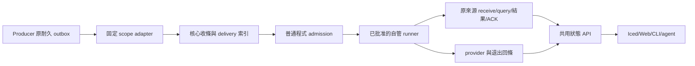

# OpenOctopus 事件入口 v1：可拆工的契約

查核：2026-10-24T04:06:15Z。EventGuard 基底：`9903ad5574e80666eb379652e7f4154d111c14b3`。
本頁是 OpenOctopus 的設計契約。方法名、資料表及狀態機是提案，尚非已發布 API。
沒有修改 OpenOctopus、啟動 server、發送任務訊息或呼叫模型。
本機產品不以此整合或桌面喚醒完成為使用前提。

## 1. 現有能力與設計界線

| 項目 | 判定與來源 |
| --- | --- |
| 七欄 snapshot | 已查程式。[queue_inbox.py:84](../src/eventguard/queue_inbox.py#L84) 產生；同檔 :93 嚴格驗證。 |
| CloudEvents 匯出 | 已查程式。[event_ingress.py:78](../src/eventguard/event_ingress.py#L78) 驗證精確八個外層欄位及七欄 data；上限 4096 bytes。:251 是唯讀 export，不投遞。 |
| 收件、query、結果及 ACK | 已查程式。[queue_inbox.py:467](../src/eventguard/queue_inbox.py#L467)、:501、:547。結果先存，再寫來源 ACK，最後保存 completed。 |
| 預算 | 已查程式。[agent_budget.py:27](../src/eventguard/agent_budget.py#L27)、:380、:462；原安裝 authority 每日五次、每事件最多三次。詳見 [預算契約](AGENT_BUDGET.md)。 |
| 容量與補收 | 已查契約。[保留政策](STORAGE_RETENTION.md) 禁止清 pending、未 ACK failed、未知退出。保留窗有限，不能聲稱無限期去重。 |
| OpenOctopus 方向 | 指定任務 [接手 COLLAB-1 整合工作](codex://threads/01a15cdb-b00a-7de0-8b9c-8b19ebcbb9a1) 的正常摘要仍在整合核心與 GUI。這不是事件入口已實作的證據。本次未讀其原始 sessions 或外部工作目錄。 |
| OpenOctopus 事件 host | 尚需實作。先在共用核心建立型別化介面；Iced、Web、CLI 與 agent adapter 共用它。不要替每個 producer 建新代理服務。 |
| Codex 平台入口 | 另見本次 [公開入口查核](AGENT_EVENT_DRIVEN.md)。本地工具已載入、事件收件與閒置喚醒必須分開驗收。 |

官方 App Server 有 `turn/start`；補入歷史不等於開回合。其命令與 WebSocket 有實驗性限制。這可作自管 provider 候選，不能據此接管任意桌面 task。[官方 App Server](https://learn.chatgpt.com/docs/app-server)。
MCP Events 列出的目的地是 Work web、桌面 Cloud 與 dots，需持久訂閱及 HTTPS callback；2xx 只表示 webhook 收件。普通本機 Codex 聊天喚醒仍未驗證。[官方 MCP Events](https://developers.openai.com/plugins/build/mcp-events)。

## 2. 最小分層



EventGuard 保留原 outbox、QueueInbox、dispatcher 與 authority。
OpenOctopus 只新增跨應用收條、訂閱與投遞索引，不複製原始 evidence 或另建 EventGuard 模型額度。
首版採明確配置的本機 adapter。邏輯契約不要求 HTTP、雲端 broker 或額外服務。
若日後暴露 IPC／loopback，需獨立定義身份、Host／Origin、大小、速率與 scope；loopback 不是授權。
Web／MCP client 斷線只結束該連線。不得代替 pause、stop、shutdown 或停止採集。
採集、佇列及 host 的生命週期由本機應用擁有，不由最後一個 MCP client 擁有。

## 3. 身分、資料與版本

EventGuard 的模型 snapshot 只有以下欄位，且鍵集合必須精確相同：

```json
{
  "event_id": "evt-synthetic-example",
  "event_type": "listener.changed",
  "transition": "new",
  "severity": "warning",
  "synthetic": true,
  "observed_at": "2026-10-24T00:00:00.000000+00:00",
  "coverage_status": "partial"
}
```

這是 schema 範例，不是已投遞事件。值仍須通過現有枚舉驗證。
不得加入產品名、路徑、PID、URL、原始 evidence、全文或任意指令。
自動 agent 的 prompt 固定。真驗收的 prompt 不預填 event ID 或內容；由綁定工具 receive 取得。
人類操作頁可依既有授權查看更多本機資料；這不擴大自動派送 snapshot。

跨應用提交沿用 `eventguard-cloudevents-minimal-v1`：
`specversion/id/source/type/time/datacontenttype/dataschema/data`。
其中 `source` 是一次配置、持久保存的 UUID4 URN；`id` 等於 data.event_id。
`time` 與 observed_at 表示同一時間。未知 extension、重複鍵及非有限數值必須拒絕。
使用現有 `validate_envelope` 與 `envelope_hash`；不要自行發明第二種 canonical JSON。

| 身分 | v1 定義 |
| --- | --- |
| 原事件鍵 | `(producer_source, namespace, event_id)`。namespace 由連線／adapter 固定，不能由事件選擇。 |
| `wire_hash` | SHA-256，依既有匯出 canonical envelope 計算。相同鍵與相同 hash 回原收條；不同 hash 回 conflict，不覆寫。 |
| 來源 `payload_hash` | 原完整 EventGuard 事件的 hash。與 wire_hash 不同。留原 adapter／來源驗證，不能從七欄重算或把兩者當同一值。 |
| `delivery_id` | host 第一次成功提交時配置並保存的 opaque ID。重送不換 ID。多訂閱只連到此索引，預設不多開模型。 |
| `attempt_id` | 一次實際模型 admission。與收件、HTTP request、lease 或 delivery ID 不同。 |
| `query_id/result_id` | 由來源 QueueInbox 回傳。host 不依自己的 hash 偽造。重收同一事件必須沿原查證與結果。 |

每個控制消息含 `version=oo-event/1`、opaque `request_id`、固定 `method` 及嚴格 params。
這些是 host 控制資料，不自動送進模型。拒絕未知版本，不暗中降級。
v1 建議 frame 上限 16 KiB、內含 envelope 上限 4096 bytes；result metadata 上限 4096 bytes。
event/query/result ID 沿用現有 1–160 字元 ASCII grammar。控制 ID 用 UUID4；hash 限小寫 64 hex。
UTC 時間只作證據及 freshness；不能用事件自帶時間替主機重置日預算或授權。

## 4. 固定操作

以下是新 host 的邏輯方法，不是 Codex、MCP 或目前 OpenOctopus 已有的方法。

| 方法 | 必要輸入與回條 | 必要行為 |
| --- | --- | --- |
| `capabilities.read` | 協定版本、來源 scope、limits、projection、provider 能力與證據等級 | `unverified` 與 `unsupported` 分開；缺能力不自動切 provider。 |
| `subscriptions.put` | 固定 source／namespace、枚舉篩選、目的 binding、policy revision、授權版本、到期時間 | 只由有權 operator 建立。事件不可指定 thread、prompt 或工具權限。 |
| `subscriptions.pause/resume` | subscription ID、expected revision、operation ID | 同一 API 給人類及已授權 agent。先存控制意圖；busy／衝突明確回報。 |
| `events.submit` | subscription ID、原 envelope、wire_hash | 驗證後先 durable commit。回 `persisted` 只表示 host 收條；來源 pending 不變。 |
| `deliveries.read` | 有界 ID／枚舉篩選與分頁 | 只讀共用狀態，不採集、不開模型、不 ACK。 |
| `deliveries.claim/renew` | delivery ID、owner ID、lease 秒數、expected fencing token | 同一交易配置 token／到期／進度。claim 本身不啟模型。 |
| `receiver.receive/query` | server 綁定的事件；query 只接受該 event ID | adapter 呼叫原 QueueInbox；query 回既有七欄及 query ID，不做額外系統查詢。 |
| `receipt.commit` | 同一 event/query ID 與既有 decision 枚舉 | adapter 呼叫既有 ack_event。先存 result，再 ACK；分別回報保存及 ACK 證據。 |
| `runs.reconcile` | 原 attempt/provider/run 參照 | 對帳原任務。不能因 sender exit、lease 過期或 PID 消失就當 provider 已退出。 |
| `host.pause/stop/status` | 授權 scope、expected revision／operation ID | pause 停新 admission。stop 合作停止 host 自有處理，不刪來源事件，不停止外部程序。 |

v1 不新增自由文字診斷、任意 shell 或不受限檔案查詢。
現有 QueueInbox 沒有獨立公開 `record_result` 操作。其 ack_event 內先保存結果，再寫 ACK。
不要把新邏輯名 `receipt.commit` 寫成已存在的 EventGuard 命令，或假造單獨結果 API。
若結果已存而 ACK 失敗，回 `result_saved` 與 `ack=pending`；沿原 query/result 重試，不新增結果或再次結案。
`reviewed_metadata` 只表示最小資料收件。`incident_conclusion` 保持 `not_assessed`。
provider 的文字分析是另一份結果。它不能自行把來源收條改成風險解除。

## 5. 狀態與交易

狀態不能壓成單一「已送達」。至少保存四個獨立維度：

| 維度 | 狀態與證據 |
| --- | --- |
| 來源 | `pending/retry/ack/failed`，以原 outbox／receipt 為準。 |
| 工具收件 | `not_received/received/queried/result_saved/acked`，以原 QueueInbox event/query/result 綁定為準。 |
| 模型任務 | `not_admitted/reserved/launch_pending/running/completed/failed/cancelled/unknown_exit`，以 admission、實際 provider 身分及終止證據為準。 |
| 人工處置 | `new/read/handled/ignored`。不影響業務 ACK，不代表安全、修補或案件結束。 |

建議核心表為 `producers/subscriptions/deliveries/delivery_subscriptions/leases/attempts/receipt_refs/control_ops`。
EventGuard adapter 的 deliveries 只索引既有事件與進度，不再建立可獨立重置的 outbox。

| 保存點 | 原子要求 | 中斷後處理 |
| --- | --- | --- |
| 提交 | 事件鍵、hash、收條及待處理索引同一 durable transaction | 提交前失敗由 producer 重送；提交後重送回原收條。 |
| Claim | owner、遞增 fencing token、期限與 revision 同交易 | 過期只可由新 owner reconcile，不直接再開模型。 |
| Admission | 原 authority 原子保存 charge、attempt、active 及 launch intent | 未確認 OS create／provider 接收前的區別由原入口保留，不能憑 host 推測。 |
| 結果／ACK | 原 QueueInbox：結果耐久成功後才 ACK，再保存 completed／完成保護 | 任一步失敗沿原證據補完。ACK 回覆遺失先查回原 receipt，不再寫第二次。 |
| 退出 | 保存實際 run/程序身分及退出回條，再解除 active | 缺回條保持 unknown；不以鎖釋放或表面成功代替。 |

主機與來源不共用交易。不得承諾分散式 exactly-once。
採至少一次投遞與冪等完成。每個跨庫保存點都必須能由相同 ID 對帳。
多訂閱預設共用一個 canonical delivery。互斥目的 binding 回 `routing_conflict`，不偷偷 fan-out 多個模型。

## 6. 租約、重試與恢復

傳輸 lease、事件 claim、模型 active 及程序 ownership 是不同概念。
每次 claim 的 fencing token 在同一 delivery 單調增加；舊 token 不能改新 owner 的狀態。
lease 到期可轉交「對帳權」，不能證明舊模型已停止，也不能退還額度。
舊 provider 的晚到證據可供驗證原 attempt，但不能獲得新啟動權。
時鐘不可信時回 `clock_uncertain`；先阻擋到期與重試推論，不把時間跳動當空窗已結束。

普通程式依序做 schema／hash、訂閱、授權、來源可用、冷卻、去重、容量及預算 gate。
無事件、被篩掉、暫停、來源離線、額度不足時不開模型。
沒有模型時可用 OS 事件、條件變數或有界資料庫檢查等待；不是讓 agent 定時醒來。
暫時傳輸錯誤可用有界退避與 jitter；保存 attempt 次數及 not-before，重啟不清零。
超過傳輸重試上限後仍留 pending／blocked，顯示恢復條件。
尚未呼叫 provider 的重試不消耗模型次數；真正 admission 後的失敗與不確定啟動照原規則計入。

若送出 launch 後失去回應，先標 `delivery_uncertain`，查原 request/run/attempt。
沒有可信對帳介面時，保持 blocked，交人類核對。不得盲目重新送出造成重複計費。
重啟先回放原 intents、active、ACK 及退出證據，再接新工作；MCP 重連也不重建空狀態。
來源離線而只剩匯出 JSON 時，不從快取宣稱 source ACK。保留索引，等待來源恢復。

## 7. 共用預算與容量

EventGuard 第一版 adapter 委派原 authority 與 runner 做 admission／啟動；OpenOctopus 不另啟一份模型。
如果未來改由 OpenOctopus provider 執行，必須先完成同一 authority 的原子 admission 及 launch intent adapter；不能只搬計數欄位。
原安裝每日五次、每事件三次、UTC+08 日界不變。驗收、取消、崩潰及未知啟動都計入，不退款。
固定 authority 不能依 cwd、run、source 或新資料夾切換。缺帳本、歷史未知或時鐘異常均阻擋，不默認剩餘五次。
多層上限只能縮小允許範圍。兩側各發五次不叫共用上限。

保存前預留結果、ACK 及退出回條的容量。滿載回 `capacity_exhausted`；I/O 失敗回 `storage_unavailable`。
兩者都不能回已保存，producer 必須保留原 pending。
只可依 [既有保留政策](STORAGE_RETENTION.md) 清已確認完成資料；未 ACK 事件、unknown_exit 任務帳本及待收尾證據不得清理。
保留窗到期後不承諾無限歷史去重。原來源與去重證據均不存在時，不用舊 JSON 重建新 pending；回 `dedup_history_unavailable`。
同帳戶可改檔的限制保留。本協定不宣稱不可竄改鑑識或全機安全。

## 8. 權限與 provider 邊界

角色至少分 observer、producer、operator、receiver、scheduler、provider。
同一核心 API 檢查 caller role、固定來源、namespace、訂閱版本及到期。人類與 agent 不走旁路；權限仍可不同。
自動接收工具的 capability 綁一個 event／attempt。事件不能自行選檔案、來源目錄、thread、provider 或批准版本。
公告、名稱、工具輸出及模型文字都是不可信資料。它們不能變成 prompt、命令、授權或新訂閱。
更新、停服務、防火牆、隔離、重啟及憑證處置均不在 v1 的自動動作內。

| Provider | v1 選擇 |
| --- | --- |
| EventGuard 自有短任務 | 沿用已存在 runner、日預算與最小三工具。OpenOctopus 只路由及讀回證據。真正模型另需當次批准。 |
| OpenOctopus 自管 provider | 後續實作。先有自有 task binding、准入、工具 scope 與可信 run／退出回條，才可啟動。 |
| 自管 Codex App Server | 候選；固定自有 thread，不控制私人 daemon。能力／成熟度與相應批准未滿足時阻擋。 |
| 任意既有桌面聊天 | `unverified`。不使用私人 socket、raw sessions、UI 模擬送出或深連結假裝喚醒。 |
| Work Cloud／dot MCP Events | 另案候選。需要訂閱、HTTPS、存取與端到端證據；不為本機核心增加部署前置。 |

ProviderAdapter 至少需要 capabilities、start、observe、reconcile 及 cancel-owned。
能力宣告需附 runtime／adapter 版本與證據等級，不能把方法存在當成功。
Windows 子程序執行前加入私有 Job。停止先合作並留寬限；逾時只可終止該 Job，記 force、原因、實際 exit 及殘留。
遠端 provider 沒有本機 Job 身分，不可借 sender exit 冒充 provider 終止。
`turn_completed`、工具 ACK 與 `process_exited` 分開存；ACK 後仍可能有 unknown_exit，active 不能因此解除。

## 9. 錯誤碼與可見狀態

v1 錯誤回 `code`、`retry_class`、有界 `retry_after_seconds` 及 opaque correlation ID；不回原始例外全文。
未知 code／未知狀態不得映成成功。EventGuard 原錯誤碼另以固定對照表保留，不改其語義。

| Code | 處理 |
| --- | --- |
| `schema_invalid/unsupported_version/scope_denied` | 拒絕此輸入，不觸發模型；不自動放寬或換 provider。 |
| `identity_conflict/routing_conflict` | 保留原紀錄與衝突摘要，停止自動推進。 |
| `busy/lease_stale` | 要求未執行；重讀 revision／lease，不推定已取消。 |
| `source_offline/capacity_exhausted/storage_unavailable` | 保留 pending；由程式在恢復條件成立後重試。 |
| `budget_exhausted/budget_unavailable/clock_uncertain` | 不啟動模型，不換目錄或清帳本。 |
| `delivery_uncertain/unknown_exit` | 對帳原 attempt；沒有可信證據時不重新啟動。 |
| `result_preserved_ack_pending/dedup_history_unavailable` | 補原收尾或保持未知，不產生第二份 ACK。 |

Iced、Web、CLI 與 agent 至少顯示來源／新鮮度、pending、容量、原預算剩餘或 unknown、最後進度、阻塞原因及四維狀態。
保存時間、工具收件、結果、ACK、provider run、自然／強制退出都有各自回條。
UI 由核心 revision 驅動；控制要求、busy 或 HTTP 成功都不能直接畫成工作完成。

## 10. 可直接分派的實作與驗收

| 工作包 | 邊界與依賴 | 可判定完成條件 |
| --- | --- | --- |
| P1 核心型別／validator | 固定消息、上限、能力與錯誤碼；不啟模型 | 正確 schema 接受；未知鍵、scope、控制字元、超限、同 ID 改 hash 拒絕。公開公告不能改權限。 |
| P2 持久收條／lease | 核心 SQLite；依 P1 | submit 重送回原 ID。交易前／後 crash 可恢復；stale token 拒絕；lease 到期不新啟模型。滿載與寫入失敗不遺失來源 pending。 |
| P3 EventGuard adapter | 沿用 export、QueueInbox、authority；依 P2 | generated／exported／received／queried／result／ACK ID 集合可核對；七欄完全相同；同事件補收沿原 query/result，receipt 計數一次。 |
| P4 共用操作頁 | Iced／Web／CLI／agent 走同一 API；依 P2 | start/pause/stop/status、篩選、實際結果、未知與新鮮度一致。MCP client 斷線後應用與採集仍在；重連不多開 owner。 |
| P5 無模型 provider 契約測試 | 明示 fake provider；依 P3 | 無事件零請求；並行不超額；paused／offline／budget 耗盡均保留事件。未知 launch／exit 不被 retry 清除。不能稱真喚醒。 |
| P6 有界真模型驗收 | 當次批准後；依 P1–P5 | 普通程式產生 synthetic 事件後才開自管短任務；真工具收同 ID，query／結果／ACK、provider 與自然退出證據吻合。 |
| P7 soak 與多來源 | 另定計畫與批准；依 P6 | 24 小時 CPU／RAM／handle／DB／模型請求數有量測，突發背壓後可恢復。短測不升格為長期通過。 |

最小故障矩陣還需覆蓋：ACK 前正常退出、結果保存後斷線、ACK 回覆遺失、來源 ACK 與 completed 間中斷、程序建立回條遺失、provider 已接但本機未存 ID、時鐘回退、權限縮小、訂閱撤銷及重啟。
每案記錄輸入事件集合、各階段 ID／hash、次數、時間、最終 pending／ACK、原用量及實際退出。
模型計畫可先批准一個短任務驗單件；ACK 前退出／補收的真模型案需要第二個任務，另計同日原額度。未批准就只執行無模型案例。
不得以登入、CLI 啟動、SDK client、HTTP 2xx、JSON 檔或模型文字代替真 agent 接收與喚醒。

## 11. 本次交付界線

本次只交付本頁協定設計與可拆工驗收。OpenOctopus P1–P7 均未在本專案實作或執行。
指定任務只經正式 read_thread 唯讀參考；原研究目錄保持不動，也未保存外專案原始命令或完整對話。
未新增 reports、安裝依賴、改設定、發事件、呼叫模型或建立背景程序。文件由主 agent 隨產品與測試一起整合，不單獨提交。
