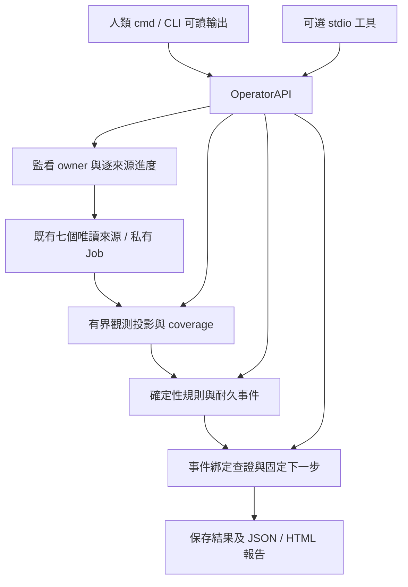

# 由使用流程往下完成 EventGuard

日期：2026-10-23（UTC+08）。基底 `d4257437757a701874c6f00de6022340bff2bc94`，同一 feature 分支，保留既有工作。這份規劃服務本輪實作，不將計畫或先前測試數當作可用性證明。

## 頂層使用結果

人類能以現有 Python 啟動唯讀監看，即時知道目前採集來源、已取得的資料量／拒讀原因；能查看保存的來源觀察及事件、執行事件綁定的白名單查證、匯出報告、合作停止並再次啟動。沒有 agent 也可完成整條流程。可選本機 stdio client 使用同一操作核心，不新增模型輪詢或永久 MCP 註冊。

## 先查到的功能斷點

- monitor 原先等整輪完成才保存 coverage／heartbeat；慢來源期間看不到進度，停止時前面已收資料可能未被保存。
- persistence 規則保存 `evidence.section`，查證計畫原先只讀 `evidence.kind`，實際規則事件無法接到持久化來源查證。
- listener 規則與查證器的程序身分綁定不足；不得用目前 PID 的建立時間冒充歷史程序。
- 缺少可直接查閱的有界來源觀察與可讀操作摘要；啟動／狀態入口主要顯示 JSON，工具收到回傳不代表人類知道發生什麼。
- 人類缺少與接收通路共用的明確 receive／query／ACK／單事件 retry；agent 失敗紀錄也可能阻擋已由其他接收者 ACK 後的後續投遞。
- query shutdown 未確認時，owner 解鎖後缺少耐久重啟閘道；Runner 也可能在下一來源覆蓋上一個未證明退出的子樹。
- 文字介面必須保留 namespace、過期與 unknown；test-only stdio 的 status 也必須守住 launcher 範圍。

後續讀碼發現需追加同一條流程內的缺口時，由整合者記錄及修正；不擴張為 EDR、GUI、新來源或雲端平台。

## 兩層分工與檔案 ownership

本輪全面盤點依操作責任收斂，沒有只增加驗收器：

| 範圍 | 盤點結果與本輪處理 |
| --- | --- |
| monitor/runtime | 補逐來源進度、即時安全觀察保存、停止／重啟閘道；Windows 原子替換的共享衝突做有界處理 |
| collectors 七來源／runner／worker | 保留既有 native/fallback、固定查詢與拒讀分類；補共用 progress、當次 listener 程序實例與未知子樹保護 |
| rules／playbooks | 保留確定性與無處置；修 persistence、resolved 與 listener 綁定，解讀可由人類完成 |
| diagnostics | 共用固定 query plan、安全投影、失敗來源不得漏出不相關列；診斷不等於入侵結論 |
| operations／CLI／cmd | 新增 scoped overview、來源資料、人類 receive/ACK/retry、可讀輸出與報告；agent 不再是必要步驟 |
| QueueInbox／dispatcher／budget | 沿用同一耐久 snapshot/query/result／ACK 與全域預算，不增接收帳本；區分合法接收與成功 agent trace |
| scripts／MCP／contrib | 只有可選 adapter 擴充同一 OperatorAPI；legacy 驗收與停用 bridge 維持既有退役邊界，未重啟模型路徑 |
| config／privacy／儲存 | 沿用既有容量政策及最小化，pending 不丟；保存來源有額外明示的列數／位元組上限，不回傳路徑或命令列 |
| tests／CI | 子代理只寫案例，主線凍結功能後統一 Windows/full/mock 與實際 CLI／SDK 協定驗證；不觸發遠端 CI |
| 文件／研究 | 更新操作入口、契約、現況及證據；既有獨立漏洞研究保留，沒有部署或新增感測面 |

| 層級 | 負責 | ownership |
| --- | --- | --- |
| 主線整合者 | 使用流程與介面、CLI可讀輸出、cmd入口、MCP對齊、跨模組整合、文件、統一驗證及提交 | cli.py、presentation.py、scripts、cmd、watch/delivery/budget整合與共用文件 |
| 第一層 runtime_lead | 採集進度、每來源保存、停止／恢復、與現有事件交易一致性 | monitor.py、runtime.py、monitor_gap.py；相關新增測試程式 |
| 第二層 collector_contract | 由 runtime_lead 分配的互斥採集契約與 progress 改動 | collectors/ 指定檔案，不碰父代理檔案 |
| 第一層 operator_lead | overview／來源觀察、事件到查證的可操作流程、報告 | operations.py、rules/、playbooks/；相關新增測試程式 |
| 第二層 diagnosis_contract | 由 operator_lead 分配的事件綁定與解讀 | diagnostics/ 指定檔案，不碰父代理檔案 |

最多兩層，受四個總並行名額限制，兩個第二層任務依空位接續。禁止同檔同時修改；子代理不遞迴擴編、不各自提交、不各跑整套測試。

## 實作後統一驗證

先完成所有功能與介面、整合及讀碼檢查；可以撰寫測試程式及做語法檢查，**期間不執行測試／驗收／實機採集**。主線凍結整合版本後，統一進行操作流程驗證、完整 Windows suite 與獨立 mock scope，失敗再針對修正重驗。

驗證要從現有 `.cmd`／CLI/API 到保存觀察、規則實際產生事件、同事件查證、報告、停止與再啟動；拒讀、慢查詢、保存失敗、未知身分不能當成成功。fixture、Python fake CLI、SDK、Windows API 與實機採集分開記錄。先前綠燈不能代替本輪流程。

一般權限、唯讀 Windows、標準庫；不啟動真模型、不提權／UAC、不下載安裝、不改安全設定、不啟用服務／排程，不做 Phase 7 注入／重開機或 24 小時 soak，不留長期背景程序。無事件不呼叫模型；agent 未接通就顯示未接通，不稱可續接任意桌面聊天。執行資料與私人資料不提交，只在 feature 集中提交、不推送。

## 操作契約

- `--format text` 為人類摘要；`--format json` 為單一 JSON 文件。auto 在互動終端使用文字，管線維持 JSON。監看進度僅在文字模式寫 stderr，慢來源不再整輪無回應。
- `overview --namespace …`、`sources list/show` 讀保存的白名單投影；每來源最多 200 列、1 MiB，沒有新掃描；total／exported／truncated／freshness 均不可省略。
- `events receive` 對同一耐久事件建立共用 query ID；`events ack` 需顯式帶同 event/query。重複 ACK 不新增回條，不等於診斷或案件結束。`events retry` 僅重試 failed outbox，不清模型／來源帳本。
- 原生 listener 在同次 OWNER_PID 表讀取中以建立時間綁定程序；PID 重用／拒讀維持未知。fallback 沒有身分就保留缺口，不用日後 PID 補歷史。
- 私有 named Job 僅供退出身分查核；unknown shutdown 耐久阻擋新 worker。只有查詢證明該 Job 已空或不存在才解除；拒讀與 legacy 缺身分保持 blocked。
- 已有合法 ACK、且所有本工具 attempt 子樹均確認退出的失敗投遞，可記 `received_without_agent_proof` 歸檔；passed 仍 false，保留 attempt_refs，不清每日預算。若 inbox 完成證據先輪替而無法重證，保留 active 與明確背壓，不猜成功。

本輪實作／驗證結果與限制統一寫入 [EVIDENCE](EVIDENCE.md)；未執行的長時／真模型／狀態注入不算完成。
