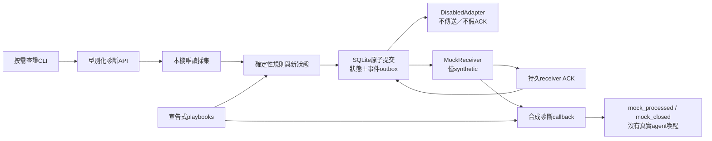

> 歷史文件：來自 `docs/ARCHITECTURE.md`，提交 `1e90a5398c5d4c555924bffb70bb77cb429dd782`；只加標記及調整相對連結，不代表現況或新授權。

# EventGuard 實際架構

本專案是無 GUI 的本機事件核心。正常採集與規則判斷不呼叫模型；正式receiver尚未接通。完整遠期產品設計見 TARGET_DESIGN，本檔只映射本版模組與入口。

## 模組與責任

| 實際路徑 | 責任與邊界 |
| --- | --- |
| `scripts/eventguard.py` | 專案內直接執行入口，載入src；不需套件安裝 |
| `src/eventguard/cli.py` | 子命令、namespace、型別化輸入、事件／診斷／mock／報告串接 |
| `src/eventguard/monitor.py` | 低頻分層監看、單例、合作式停止與健康紀錄 |
| `src/eventguard/runtime.py` | 專案執行目錄與live／test隔離、runtime狀態與檔案操作 |
| `src/eventguard/synthetic.py` | 安全合成事件／診斷fixture，不修改真實系統狀態 |
| `src/eventguard/collectors/runner.py` | 有界本機PowerShell程序；無shell=True／繞過執行政策，取消不終止程序，pending查詢不重疊 |
| `src/eventguard/collectors/windows.py` | 固定唯讀來源，回傳狀態、時間、rows、coverage，排除完整命令與私人內容 |
| `src/eventguard/diagnostics/api.py` | 操作與args白名單、範圍驗證、濾選／限額與結構化錯誤 |
| `src/eventguard/rules/detector.py` | 純確定性規則／基線／轉態，產生新state與事件；不自行取得處置權限 |
| `src/eventguard/rules/playbooks.py` | 宣告規則驗證、節點連線、dry-run；沒有任意shell與隱含批准 |
| `src/eventguard/events/schema.py` | 版本、欄位白名單、最小化與事件大小驗證 |
| `src/eventguard/events/store.py` | detector state與outbox同一transaction提交；去重、lease／重試／ACK、容量與保留 |
| `src/eventguard/transport/adapters.py` | 停用adapter及只本機mock receiver；沒有正式模型／網路adapter |
| `playbooks/default.json` | listener、防毒、啟動變更、coverage故障調查參考；allowed_actions預設空 |
| `config/default.json` | 分層時間、15秒查詢逾時、300秒cooldown、20個一般事件／evaluation等預設 |

`src/eventguard/__main__.py`可供模組入口使用；建議操作仍用`scripts/eventguard.py`，不需改全域Python套件配置。CLI的實際可用性由整合驗收記錄於STATUS。

## 一致性與故障

規則輸出state與events由EventStore原子提交；容量或transaction失敗不能先標已通知而丟事件。相同event_id重送保持身分；ACK是receiver耐久接收，不是診斷／處置結果。恢復需完整成功觀測，缺section、partial、unknown、denied不能清除既有觀測。

預設一個監看writer、查詢併發1、分層頻率與合作式停止。已開始的唯讀OS查詢自然結束前不再累積查詢。逾時、休眠、程序停止或資料來源故障都必須保留coverage；本機完全停止時沒有獨立watchdog。

data/live是實際監看，data/test是fixture／合成事件／mock；namespace隔離，不能以test資料更新live基線或假裝正式傳輸。data／logs／reports只承載執行資料且忽略版本控制。SQLite、playbook、診斷與receiver結果各有獨立schema用途。事件及工具回應是不可信資料，不能成為操作指令。不得向外部agent傳資料前自行擴張批准範圍。
