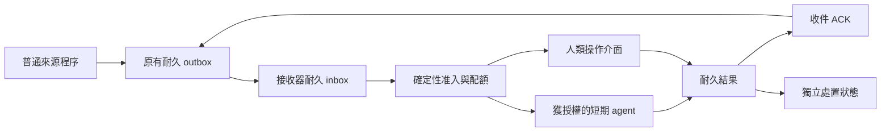
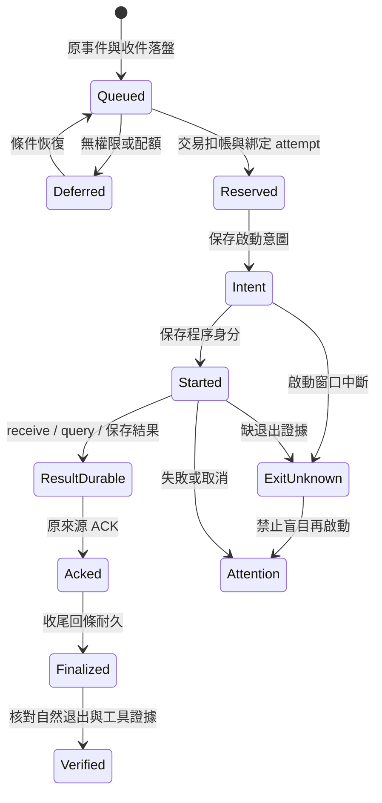

# 跨應用 agent 事件入口：最小協定設計

> 保存註（2026-10-28）：以下「目前／本輪／未提交」與政策均指原研究日期及固定基準，不是現行能力、授權或驗收。現況以 [STATUS](../../../STATUS.md) 與 [HANDOFF](../../../HANDOFF.md) 為準。本頁 reports 連結是「本機證據、不隨repo提供」；本次未讀取或上傳 reports 內容。

研究日期：2026-10-24。時區：UTC+08。

本文件是研究與設計。不是已部署功能，也不是桌面喚醒驗收。
本輪沒有啟動模型、背景程序、服務或排程。沒有新增密鑰。

## 決策

採用 CloudEvents 1.0 的事件封裝。
只補足耐久收件、啟動准入、結果與 ACK 的小型應用契約。
用 AsyncAPI 描述介面。不要建立新的通用代理服務或訊息平台。

EventGuard 保留原有 EventStore、QueueInbox、dispatcher 與預算 authority。
OpenOctopus 應提供獨立於模型的事件接收器。
平台 adapter 只負責轉接。它不能決定處置權限。

普通程序可以 poll 來源、等 OS 通知，或維持長連線。
這些工作不需要模型。沒有合格事件時，模型啟動數必須為 0。
這不代表 CPU、電力、儲存與網路成本為 0。

## 已讀證據與界線

本機已讀：AGENTS、README、HANDOFF、STATUS、LIVE_CHANNEL、AGENT_BUDGET、STORAGE_RETENTION 及 LOCAL_MCP_EXPERIMENT。
另讀 `src/eventguard/queue_inbox.py` 的 projection、receive、query、result、ACK。
另核對 `agent_budget.py` 與 `agent_dispatch.py` 的准入及等待狀態。

| 項目 | 已核對內容 | 不可推論 |
| --- | --- | --- |
| QueueInbox | 七欄 snapshot；query ID 綁同 event 與 payload；先存 result，再 ACK | agent 已診斷或主機安全 |
| dispatcher | 無事件由普通程序等候；一次專用任務；失敗待人工查核 | 任意桌面聊天可被喚醒 |
| 預算 | 固定安裝 authority；每日五次；跨程序交易；未知退出阻擋 | 帳戶所有工具都受同一額度限制 |
| 保留 | 不清 pending；容量不足明示背壓；完成證據有限保留 | 永久去重或無限恢復 |

原始碼位置：`queue_inbox.py:84`、`:467`、`:501`、`:547`；`agent_budget.py:380`；`agent_dispatch.py:431`。
此處行號是研究時定位。改版後須再核對。

## 標準有提供什麼

CloudEvents 1.0.2 定義事件格式。
必要 context 為 `specversion`、`id`、`source`、`type`。
同一事件重送可保留 `source + id`。
它沒有替本應用定義 agent 啟動、結果保存或處置結案。
HTTP binding 提供 structured 與 binary 映射。[CloudEvents](https://raw.githubusercontent.com/cloudevents/spec/v1.0.2/cloudevents/spec.md)、[HTTP binding](https://raw.githubusercontent.com/cloudevents/spec/v1.0.2/cloudevents/bindings/http-protocol-binding.md)。

AsyncAPI 3.1.0 可描述 channel、message、send／receive operation、binding 與安全需求。
它是介面文件格式。它不替執行程式保存事件或執行重試。[AsyncAPI](https://www.asyncapi.com/docs/reference/specification/v3.1.0)。

OpenAI 的 MCP Events 官方頁列出 Work web、桌面 Cloud 與 dots。
要求 MCP 2.0／`2026-07-28`、持久訂閱及 HTTPS callback。
目前該產品整合只支援 webhook。不是一般本機 stdio MCP 的喚醒保證。
其 `2xx` 只證明 webhook 收件。事件可亂序。
帳戶及本機桌面能力仍需另驗證。[OpenAI Docs](https://developers.openai.com/plugins/build/mcp-events)。

官方頁連結的 MCP Events 上游仍標示 Draft proposal。
草案另有程式級 poll、stream 與 webhook。
poll 是 client runtime 的工作，不是 LLM 工具輪詢。
不要將草案所有方法、控制通知與錯誤碼視為 OpenAI 已支援。
例如 callback 錯誤碼在兩份文件已不同。
adapter 必須綁定平台及版本。[MCP Events 草案](https://github.com/modelcontextprotocol/experimental-ext-triggers-events/blob/main/docs/design-sketch-proposal.md)。

MCP transport 的 server notification 與 SSE 恢復，是通訊能力。
不能單獨證明宿主會替閒置聊天建立模型回合。
宿主必須實作明確的事件消費與啟動策略。[MCP transport](https://modelcontextprotocol.io/specification/2025-11-25/basic/transports)。

## 架構與權限



同一 EventGuard 安裝內，圖中的 outbox 與 inbox 使用既有儲存。
不要只因畫了箭頭，就增加第三份代理佇列。
跨應用或跨主機才建立各自的收件信任邊界。
每個 adapter 都映射到同一准入與結果契約。

通知表示「有資料可查」。它不是命令。
事件的嚴重度、來源名稱、文字與 schema，都不能授予操作權限。
agent 的能力來自使用者設定的授權 profile。
外部事件不能選擇 shell、工具、檔案根目錄、密鑰或 target thread。

## 封裝與七欄模型資料

下例是建議 wire 形式。不是本輪已新增的 API。
`source` 是 opaque producer scope。不得含使用者或主機名稱。
`dataschema` 是本機驗證用的版本識別。不得因它自動下載 schema。

```json
{
  "specversion": "1.0",
  "id": "evt-public-example-001",
  "source": "urn:uuid:ec20e5d7-8410-4b70-9f6c-8a6727617397",
  "type": "org.eventguard.snapshot.v1",
  "time": "2026-10-24T02:00:00Z",
  "datacontenttype": "application/json",
  "dataschema": "urn:eventguard:snapshot:1",
  "data": {
    "event_id": "evt-public-example-001",
    "event_type": "advisory.changed",
    "transition": "new",
    "severity": "high",
    "synthetic": true,
    "observed_at": "2026-10-24T02:00:00.000000+00:00",
    "coverage_status": "partial"
  }
}
```

模型只取得 `data` 的既有七欄。
這份封裝不擴充 EventGuard snapshot。
adapter 必須核對 `id == data.event_id`。外層 `time` 與 observed_at 須指向同一時刻。
相同 `source + id` 但不同不可變內容，必須拒絕為身分衝突。
不得以更新內容的方式悄悄重用舊 ID。

下列欄位只在接收器本機保存，不放入模型 prompt 或工具返回：

| 本機 metadata | 用途 |
| --- | --- |
| producer principal、installation scope | 授權來源與配額歸屬 |
| subscription ID、consumer ID、target binding | 路由；target 由既有設定綁定 |
| received_at、durable receipt ID、cursor | 接收與恢復 |
| validated payload hash、schema profile | 防同 ID 改寫；只採本機驗證值 |
| group ID、priority、not_before、policy revision | 合併、排序、冷卻 |
| attempt ID、launch intent、lease owner／generation | 防止重複啟動 |
| budget reservation、result／ACK／exit refs | 配額與證據鏈 |
| local evidence handle | 指向本機證據；不暴露路徑 |

原有 hash 與七欄驗證器沿用。
新 wire adapter 可先正規化固定 schema，再計算自己的 wire hash。
不得把重排 JSON 空白當成新事件。
wire hash 與既有 EventStore payload hash 不能混用。
未知重大版本須隔離並顯示 `unsupported_schema`。不得猜測解析。
新增可選外層欄位仍須設定大小及型別上限。
隱私投影採明確 allowlist，不採「排除已知秘密」的黑名單。

## 訂閱與啟動是兩個開關

訂閱資料：producer、事件種類、固定 filter、consumer、起點、有效期、schema profile。
啟動資料：`auto_invoke`、授權 profile、配額 authority、每次時限、並行上限。

只有訂閱不代表允許用模型。
預設 `auto_invoke=false`。人類仍可查看與接手。
暫停只阻擋新 agent 任務。原始事件仍須保存。
停止採集與停止派送要分開顯示，避免誤認仍在監看。

建立或更新訂閱須冪等。
相同 principal、producer、filter、consumer 不建立兩份相同訂閱。
改權限或 target 須留版本及審查記錄，不能由事件內容更新。
授權撤回後不啟新任務。已保存資料依既有保留及存取政策處理。
訂閱過期、宿主離線及權限不足，均顯示原因。

第一版只有一個明確的 required consumer。
未來 fan-out 時，每個 consumer 有獨立 receipt、result、ACK 與進度。
來源 ACK 要等待已固定的 required consumer 集合完成。
optional consumer 不阻擋來源 ACK，但須有自己的保存與缺口政策。
一個 consumer 完成不能自動代替所有人 ACK。
required 集合的變更是授權操作，不能靠改訂閱悄悄清除既有義務。

## 狀態必須分開

| 軸 | 狀態例 | 意義 |
| --- | --- | --- |
| 來源保存 | pending／retained／capacity_blocked | 來源是否仍有原事件 |
| 傳輸 | retrying／accepted_durable／rejected | 對端是否耐久收件 |
| 准入 | queued／deferred_budget／paused／attention | 是否可啟動 |
| 任務 | reserved／launch_intent／started／exit_unknown／exited | 真正程序生命週期 |
| 處理 | not_received／received／queried／result_durable | agent 或人類完成哪一步 |
| ACK | not_acked／acked／finalization_pending | 收件鏈是否耐久收尾 |
| 案件 | new／read／handled／ignored | 人類操作；不等同修補 |

HTTP 成功、agent 啟動、結果存在、ACK 與風險結案各是不同證據。
不以一個 `success=true` 代替全部狀態。
HTTP 202 本身也不保證後續處理成功。[RFC 9110](https://www.rfc-editor.org/rfc/rfc9110.html#section-15.3.3)。



這是邏輯圖，不要求所有動作只依一條線發生。
例如 child 可以在 ACK 後崩潰。ACK 仍有效，但自然退出驗收失敗。
也可在保存結果後退出、尚未 ACK。恢復時須用原 query／result 補收尾。
必須同時查看各狀態軸。

## 至少一次與冪等副作用

交付採 at least once。重送是正常狀況。
只在雙方保存窗、可用容量與重試政策內提供恢復。
不承諾分散式 exactly once。

接收主鍵是 `(producer_scope, event_id)`。
同主鍵同內容回同一耐久 receipt，不新增模型工作。
同主鍵不同內容回 `identity_conflict`，保留原件並告警。

首次啟動鍵是 `(subscription_id, producer_scope, event_id)`。
policy 更新或 dispatcher 重啟不自動換鍵。
明確重試才增加 retry generation，並再次核對權限及扣帳。
這個鍵可避免一般重複請求。它不能消除 OS create 前後的崩潰窗口。
窗口不明時標 `exit_unknown`，不能因 lease 到期就再叫一次模型。

agent 若有可寫工具，每個副作用也要有獨立 operation key 與耐久回條。
查到已完成回條就返回原結果，不重做處置。
無法提供冪等或查核的工具，不應放入無人自動事件流程。
本輪仍只研究唯讀與收件，不新增處置權限。

## 租約、順序與回放

lease 只代表目前 owner。它不代表程序已退出。
租約有單調 generation。每次寫入必須核對 owner 與 generation。
過期 owner 的結果可保存供查核，但不可覆寫新 owner 的狀態。
Windows 本工具 child 仍須先加入私有 Job，再執行。
PID 不存在、鎖釋放或 heartbeat 過期，都不足以證明整棵程序樹退出。

順序只在同來源或同關聯群內要求。全域沒有總排序保證。
以保存的 sequence／cursor 處理恢復，不用牆鐘時間當唯一順序。
較舊事件可保留歷史。不能回滾較新的 exposure／案件觀察狀態。

收件 cursor 與處理 cursor 分開。
只有原子保存完一批事件後，才前進收件 cursor。
agent 尚未處理的事件仍留 inbox，不因讀取下一批而跳過。
回放窗不足時回 `gap`／`truncated` 及範圍。不得回空陣列冒充無事件。
不支援該控制訊號的平台，須轉成本機可見的 coverage 狀態。
不得把 replay gap 偷換成一般產品安全事件，或先啟動模型再決定。

起點必須明確選擇：目前位置、保存 cursor，或既有 pending。
舊積壓不得在升級後無預告全部啟動 agent。
有限保留窗以外的重複仍可能再出現。status 必須揭露去重最早時間。

## 合併、背壓與配額

dedup 只消除同一 ID。coalesce 用於多個相關 ID。
合併不能刪除原件，也不能偽造各事件已 ACK。
目前 EventGuard 一任務一事件，不在研究中偷偷改成批次模型契約。
第一版只合併通知及等待排序。每個原件仍走既有七欄收件。
日後批次須另定每個 ID 的結果、ACK 與部分失敗契約。

採固定 severity 排序，加等待年齡，避免低優先級永久飢餓。
同群冷卻只延後新啟動。不可延後原事件落盤。
升級、修補撤回或暴露惡化，可依固定規則突破一般冷卻。
規則不可由公告文字修改。

| 壓力 | 必須行為 |
| --- | --- |
| ingress rate limit | 先拒絕新傳輸並回建議重試時間；producer 保留原件 |
| outbox 滿 | 明確保存失敗；保留既有 pending；標示採集缺口 |
| inbox 滿 | 不回 durable accepted；不刪未處理件 |
| ledger 滿 | 不啟動；預留結果及 terminal update 空間 |
| 每日模型額度滿 | `deferred_budget`；等待普通程式日界檢查，不叫模型 |
| unknown exit | `attention`；保留 active 與扣帳，不盲重試 |
| 永久壞格式 | 隔離並顯示；不得重試風暴，也不得當已處理 |

EventGuard 沿用固定 `data/agent-budget` authority 與每日五次政策。
驗收、失敗、取消與不確定啟動都計入。
同一 SQLite 交易核對日額、事件次數、active，再扣帳及建立 reservation。
quota 不是授權。配額可用仍不表示可啟動模型。
不因換 run／source／cwd 重置。不因 status 讀取建立新額度。
同使用者多 checkout 的帳戶總量限制，屬尚未提供的更大邊界。

傳輸重試可由普通程式指數退避加 jitter。
它重送同一 ID，不扣模型預算。
模型失敗預設轉 attention。不得把 HTTP 重試規則套成無限模型重試。

## 本機與遠端 binding

| binding | 推薦用途 | 必要界線 |
| --- | --- | --- |
| 既有 SQLite＋本機 owner wake signal | 同一 EventGuard 安裝 | SQLite 是真相；signal 只提示可讀。遺失 signal 可低頻查 pending |
| 受限 named pipe／Unix socket | 本機跨應用 | 驗證 OS principal；有界 frame；普通程序等候；不經模型維持連線 |
| loopback HTTP | 已有本機 Web host 的跨應用 | 僅 loopback；驗證 Host、Origin 及能力授權；限大小／並行／逾時；不得誤認同機等於可信 |
| HTTPS CloudEvents structured JSON | 遠端產品互通 | 明確批准後才加身分／簽章；耐久 receipt、重送、狀態查詢 |
| 平台 MCP Events adapter | 平台已支援事件訂閱 | 依平台實際版本轉換；不把它當通用本機喚醒能力 |

本機先用既有資料庫及操作層。無需先開遠端埠或建雲端服務。
stdio MCP server 一般由 client 啟動。client 關閉時，不能假設它仍能接收事件。
若宿主不支援無模型事件入口，普通 dispatcher 可在授權後啟動專用短任務。
這不是喚醒任意桌面會話。

CloudEvents 不是 OpenAI MCP Events 的原始 wire envelope。
轉接時，`id → eventId`、訂閱固定事件種類 `→ name`、`time → timestamp`、七欄 `data → data`。
`source` 留在本機 routing binding；跨來源須維持不碰撞的 eventId 映射。
`cursor` 由訂閱的耐久接收進度產生，不是用事件時間猜測。
固定映射不得悄悄改七欄中的 event_id；無法保持同 ID 時須先報契約衝突。
轉接後驗證兩邊 schema。不能直接把 CloudEvents JSON POST 到平台 callback。

若使用 `codex queue --message`，它是 user prompt 入口。
只能傳固定、由 host 擁有的通知。不可放公告、外部 URL、事件正文或偽授權。
例如固定通知只要求：「有待收事件。依既有授權，使用 EventGuard 工具接收一次。」
事件資料仍由已綁定的型別化工具提供，保持七欄。
該命令是否能安全喚醒本機目標、是否耐久及冪等，仍須另驗證。
不能因 queue exit 0 就 ACK 來源。[桌面入口研究](CODEX_DESKTOP_FINDINGS.md)。

建議遠端最小 HTTP profile：

1. 一個受驗證的 event POST。`application/cloudevents+json`。先驗證及耐久保存，再回 receipt。
2. 一個受驗證的 receipt status 查詢。回多軸狀態及固定原因碼。
3. 一個受驗證的 replay／subscription 操作面。只接受型別化 filter。
4. `409` 表示同 ID 內容衝突。`413` 表示太大。`429`／`503` 表示暫時背壓。
5. `2xx` 不代表模型已啟動。錯誤仍由 producer 留原件。重試不可更換 ID。

以上是本設計的 profile。不是 CloudEvents 自帶的端點名稱或狀態保證。
第一版可以只實作本機 binding。

Standard Webhooks 規定穩定 ID、每次傳送時間與簽章 header。
驗證應使用原始 body，不要重排 JSON 後再驗簽。[Standard Webhooks 1.0.0](https://raw.githubusercontent.com/standard-webhooks/standard-webhooks/main/spec/standard-webhooks.md)。
驗簽後仍須做 durable 去重。簽章只證明來源，不證明事件內容安全或有權處置。
callback URL 不得由事件正文提供。防 SSRF、redirect 與重放須由 adapter 執行。
本輪沒有建立 endpoint、簽章秘密或傳輸授權。

## 人類與 agent 共用操作

兩者使用同一 domain service：list、inspect、receive、query、save result、ACK、案件狀態。
CLI、Web、MCP 只是轉接。不得各自發明另一套 ACK 與事件狀態。
每次操作保存 actor、scope、時間、事件／query／result ID 與固定結果碼。
agent 可見 actor 用 opaque ID，不洩露本機帳戶名。

人類可讀完整本機證據，不代表模型可讀。
目前 EventGuard 的 agent query 只返回已保存的七欄摘要。
所以目前它可證明收件，不能替代漏洞診斷。
若要增加診斷，須另定有界、型別化、事件綁定的 read-only capability。
新增資料披露與查詢範圍要另審，不偷加產品名或路徑到七欄。
`reviewed_metadata` 必須保留 `incident_conclusion=not_assessed`。

人類與 agent 同時 ACK 時，第一份合法 result／receipt 勝出。
相同 result 重送返回原回條。不同結論不得靜默覆寫。
修改處置狀態是另一個明確操作。ACK 不自動標 handled。

## OpenOctopus 最小支援要求

這是應交給 OpenOctopus 的需求。尚未證明該專案已有實作。

- 接收器與模型 runner 分離。空閒時 runner 可以不存在。
- 本機事件入口、耐久 inbox、事件來源 allowlist 與明確訂閱。
- 共用准入服務。提供 pause、配額、並行、冷卻、去重與 attention。
- `enqueue`、`accepted_durable`、`invocation_started`、`result_durable`、`ack`、`exit_verified` 分開可查。
- 對指定 thread 的投遞須有 owner 授權及穩定 binding。不得任意列出或探查其他聊天。
- thread 忙碌時先排隊。待安全 turn 邊界處理。預設不注入正在執行的工具回合。
- thread 閒置時，只有合格事件與有效自動授權才建立新 turn。
- thread 已刪除、離線或 schema 不符時，保留 pending 並顯示阻塞。
- capability discovery 表示實際能力。不能用「支援 MCP」代替「支援事件喚醒」。
- status 顯示最後事件、最後模型啟動、待收數、阻塞、配額、未知退出、replay 缺口與去重窗。
- 人類可關閉自動模型處理，同時保留採集、儲存與手動分析。

實作順序：先本機 durable enqueue／status，再確定性准入，再短任務 runner。
其後才做指定 thread binding。遠端與平台 adapter 最後做。
不要讓 EventGuard 的產品進度依賴特定聊天平台先完成全部功能。

## 反例驗收矩陣

下表是待執行規格，不是本輪通過證據。
離線、fake runner、真模型及長期實機結果須分列。

| 注入或反例 | 必須觀察到 | 不能接受 |
| --- | --- | --- |
| 24 小時無事件 | 模型 starts／requests 均為 0；普通程序資源可量測 | 用模型定時醒來問有無事件 |
| 同 ID 重送十次 | 同 receipt、同初始 admission，最多一個初始 invocation | 十次模型啟動 |
| 同 ID 不同 data | identity_conflict；原件不變 | 後件覆寫前件 |
| 只改 JSON 排版 | 正規化後判同件 | 新案件或新模型 |
| outbox 已存，網路斷 | pending 可查；恢復同 ID 重送 | 逾時就清件 |
| inbox commit 後回應丟失 | 重送取原 receipt；不重啟 | 新 receipt／新扣帳 |
| 十個 producer 並行達日額 | 交易總量不超五次；其餘 pending | 各程序自行算剩餘額度 |
| 換 run 目錄或跨重啟 | 同 authority 與當日用量 | 新目錄發五次 |
| launch intent 後崩潰 | unknown／attention；保留 active | lease 過期就再啟動 |
| child PID 消失，缺子樹收條 | exit_unknown | 假造 child_exited=true |
| result 已存，ACK 前退出 | 恢復同 query／result，再 ACK 一次 | 生成另一組不相符 ID |
| ACK 完成，收尾寫入失敗 | 原 proof 受保護；恢復補收尾 | 當垃圾清除 proof |
| ACK 完成，child 非零退出 | ACK 可查；自然成功驗收 false | 一律 success |
| case 已 handled，delivery 未 ACK | 處置狀態保留；pending 不刪 | handled 等同收到 |
| 新事件排在舊事件前到達 | 不回滾新狀態；歷史可查 | 用到達次序宣稱最新事實 |
| cursor 超過保留窗 | gap／truncated 可見；不報安全 | 空清單當零事件 |
| inbox／ledger／磁碟滿 | 明確背壓；原 pending 可恢復 | 回成功後丟棄 |
| 合併群中一件失敗 | 每個 ID 的結果與 ACK 分列 | 群已完成代表全部完成 |
| 多個 required consumer，一個未完成 | 各 receipt 可查；source pending 保留 | 第一個 ACK 就全域清件 |
| 公告含命令／URL／偽授權 | 只當資料；工具能力不增加 | 執行正文或擴大 scope |
| queue message 企圖攜帶原始事件 | adapter 拒絕；只允許固定 host 通知 | 把不可信資料當 user 指令 |
| 已暫停時有事件 | 保存、顯示；模型 starts=0 | 暫停後仍自動啟動 |
| thread 忙碌或已刪除 | 等安全邊界或明示阻塞 | 侵入他人聊天或靜默改 target |
| 平台 webhook 回 2xx | 只標 transport accepted | 稱 agent 已醒、已診斷 |
| 收到普通 MCP notification | 記錄 host 處理能力是否存在 | 只看通知送出就稱喚醒 |

## 推薦與成本

| 方案 | 收益 | 成本與限制 | 建議 |
| --- | --- | --- | --- |
| CloudEvents＋小型本機 binding | 跨應用可讀；沿用現有耐久層；零模型閒置 | 仍要實作准入、回條及恢復 | 先做 |
| MCP Events 平台 adapter | 支援平台可事件觸發指定工作 | 帳戶／平台支援、訂閱、HTTPS 與秘密生命週期 | 能力核實後選配 |
| AsyncAPI 文件 | 產生可檢查介面與範例 | 不代替 runtime | 跟著最小 binding 做 |
| 自造大型 agent event protocol | 可包含所有偏好 | 新版本、安全、互通、維運成本很高 | 不做 |
| 模型輪詢網站或長期 wait 工具迴圈 | 早期展示容易 | timeout、token、回合及恢復行為不穩 | 不採用 |

最小下一步是對現有通路加一份機器可驗證的封裝與 adapter 契約。
先跑無模型反例測試，再取得有限真任務範圍後驗證實際啟動。
桌面原聊天的喚醒另做能力驗收。它不阻擋本機採集與事件保存。
