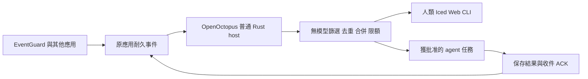

# 事件驅動 agent：研究結論

> 保存註（2026-10-28）：以下「目前／本輪／未提交」與政策均指原研究日期及固定基準，不是現行能力、授權或驗收。現況以 [STATUS](../../../STATUS.md) 與 [HANDOFF](../../../HANDOFF.md) 為準。本頁 reports 連結是「本機證據、不隨repo提供」；本次未讀取或上傳 reports 內容。

日期：2026-10-24，UTC+08。程式基準：`008a931121f03c1ceaa1abb6f26cbe08abf3bf48`。

本批是三路平行研究與整合。沒有新增產品功能或啟用模型。
沒有變更設定、排程、服務、登入或正式背景。沒有新增 reports。沒有文件單獨 commit。

## 目前可以下的結論

Codex 有可由程式呼叫的入口。不能宣稱桌面在技術上做不到事件喚醒。
但 EventGuard 事件能否直接喚醒這個既有桌面聊天，仍缺實測。

本機桌面 app 為 `26.1016.62342`，build `21477`，prod 通道。
既有原生 CLI 為 `0.163.0-alpha.11.2`。
版本與 help 可用，不等於事件已喚醒。

官方列出 Stable 的 `codex queue`。它可向既有 session 排入訊息。
本機 help 也存在。最值得先驗的是它是否真的路由至目標桌面聊天，並從閒置開始新回合。
本輪沒有送訊息。[官方 CLI](https://learn.chatgpt.com/docs/cli/reference)。

MCP Events 有官方事件觸發流程。支援範圍列 Work web、桌面 Cloud 與 dots。
不能直接把它當成本機 Codex 聊天的支援證據。
普通 MCP 工具、Hooks、deep link 都不能單憑存在便判斷已喚醒。[官方 MCP Events](https://developers.openai.com/plugins/build/mcp-events)。

## 推薦的產品架構

等待、來源擷取、重試與路由由普通程式完成。
有合格事件才建立模型回合。沒有事件、正在冷卻、未批准或額度耗盡時，模型請求數為零。
這是設計及驗收要求。本輪未作長期量測。
普通程序仍會使用 CPU、RAM、儲存與網路。不能稱全部成本為零。

OpenOctopus 應優先控制自己的任務與會話。
這能提供明確的目的地、回合狀態、停止與結果證據。
任意既有 Codex 桌面聊天是獨立 adapter，不能成為核心前置條件。

## 入口比較與成本

| 路徑 | 收益 | 主要成本與限制 | 建議 |
| --- | --- | --- | --- |
| `codex queue` → 已綁定桌面聊天 | 有機會保留既有聊天脈絡 | 目的後端、閒置啟動、重送與回條未驗證；訊息可能變成 user prompt | 先作有限候選驗收。失敗保留事件，不偷換目的地 |
| 既有專用 `codex exec` | EventGuard 已有普通程序等待與短任務路徑 | 真通路仍待驗；每次可能有多個模型請求；不續接原桌面聊天 | EventGuard 最小可用候選。先修復既有預算阻塞，再獲批准真驗 |
| OpenOctopus 自管 host＋provider adapter | 可統一 UI、事件、預算、回合與結果 | 需實作 Inbox、admission 與生命週期；不能只包一層 prompt | 長期首選。普通 host 不進行模型推理 |
| 自管 Codex app-server | 有程式級 thread／turn 控制 | 官方仍標實驗性與生產限制；須版本固定、能力協商及獨立驗收 | 可替換 adapter，不能綁死核心或默認為正式可靠 |
| Work／dot MCP Events | 有官方訂閱及事件流程 | HTTPS、訂閱、驗證 secret、平台與資料傳輸範圍 | 選配。不要強加成本機產品的雲端前置 |
| 讓模型定時查看／永久等工具 | 表面上接線簡單 | 不符合閒置零請求；長工具時限與恢復也不可靠 | 不採用 |

上表是相對工程成本，不是價格估算。一次任務可能有多次模型請求。
實際 token／費用應取 provider 用量回條；缺失時顯示未知。
app-server 限制來源：[官方 app-server](https://learn.chatgpt.com/docs/app-server)。

## 協定決定

推薦 CloudEvents 1.0 封裝，加一份小型應用契約。AsyncAPI 用於描述介面。
CloudEvents 只定義事件格式，沒有替應用提供耐久性或喚醒。
OpenAI MCP Events 是另一種 wire envelope，必須由 adapter 明確映射。

共用契約必須包含：

1. 固定 producer scope、事件 ID 與內容 hash。重送同內容回原收條；同 ID 改內容則拒絕。
2. 訂閱與自動啟動分開。目的地、資料範圍及工具權限由人類綁定。
3. 先落盤再准入。篩選、合併、冷卻、並行與預算不用模型。
4. 分開記錄傳輸收件、模型啟動、工具收件、結果保存、ACK 與處置結案。
5. 未知啟動或退出先核對。不因租約到期、鎖釋放或 HTTP 逾時就盲目重開模型。
6. 至少一次投遞及冪等處理。保留 pending。滿載、重播缺口與離線明示原因。
7. 合併保留原事件 ID。首版只有一個 required consumer；多 consumer 的收條必須分開。
8. EventGuard 七欄不變。完整證據留本機。診斷查詢需要獨立型別化 capability 與資料授權。

七欄收件可用，不代表 agent 已具備診斷資訊。
不能只改結果名稱或寫一段「已分析」就算有價值。
未來須量測與確定性 playbook 相比，agent 是否增加可核對的事實或建議。

正式規格與反例驗收矩陣見 [協定設計](PROTOCOL_DESIGN.md)。

## 實作順序

1. OpenOctopus 共用 Rust 核心完成無模型 Inbox、訂閱、狀態及 admission。fake provider 明示 fake。
2. 接 EventGuard 原佇列及七欄資料。沿用原預算 authority，不再發另一份五次額度。
3. 實作可替換的短任務 provider，保留完整結果、ACK 及退出證據。
4. 另獲有限真模型批准，驗證真正事件喚醒。不能拿 fake 或收件回條替代。
5. 再做長時、重啟、突發、公平性及資料保留測試。

針對既有桌面 queue 的候選驗收另見 [ACCEPTANCE_PLAN](ACCEPTANCE_PLAN.md)。

## OpenOctopus 交接

已唯讀參考使用者指定的 OpenOctopus 整合任務摘要。
其 Iced／共用 Rust 核心方向與本設計相符。沒有獨立編譯或驗證外部專案。
必備需求、分批完成條件及可貼 prompt 見 [OPENOCTOPUS_REQUIREMENTS](OPENOCTOPUS_REQUIREMENTS.md)。

沒有向該聊天發訊息，也沒有修改其程式或目標。這份需求尚未導入該任務。
後續交接只傳設計與要求，不傳私人對話、執行資料、登入或帳本。
